<p align="center">
  
</p>

<p align="center"><b>16.22 - Informática Médica</b></p>

<h1 align="center">Trabajo Práctico 4:<br>Bases de Datos + Manejo de Versiones</h1>

**Número de grupo:** 5

**Integrantes:**

- 64422 - Natasha Alexandra Kim
- 64436 - Juana Rives
- 64376 - Leila Sol Winkler

**Fecha de entrega:** 19/10/2026

---

## Índice

- [Actividad 1](#actividad-1)
  - [1. Tipo de base de datos](#1-tipo-de-base-de-datos)
  - [2. Modelo conceptual (Chen)](#2-modelo-conceptual-chen)
    - [2.1. Notación utilizada](#21-notación-utilizada)
    - [2.2. Entidades](#22-entidades)
    - [2.3. Relaciones, cardinalidad y participación](#23-relaciones-cardinalidad-y-participación)
  - [3. Modelo Relacional (Diagrama de Crow’s Foot)](#3-modelo-relacional-diagrama-de-crows-foot)
    - [3.1. Notación utilizada](#31-notación-utilizada)
    - [3.2. Proceso de mapeo](#32-proceso-de-mapeo)
    - [3.3. Descripción de las tablas](#33-descripción-de-las-tablas)
    - [3.4. Cardinalidades, nulabilidad y restricciones de integridad](#34-cardinalidades-nulabilidad-y-restricciones-de-integridad)
    - [3.5. Consideraciones sobre la normalización](#35-consideraciones-sobre-la-normalización)
  - [4. Errores de Normalización](#4-errores-de-normalización)
    - [4.1. Caso 1](#41-caso-1)
    - [4.2. Caso 2](#42-caso-2)
    - [4.3. Caso 3](#43-caso-3)
    - [4.4. Caso 4](#44-caso-4)
- [Actividad 2](#actividad-2)
  - [Consigna 1](#consigna-1)
  - [Consigna 2](#consigna-2)
  - [Consigna 3](#consigna-3)
  - [Consigna 4](#consigna-4)
  - [Consigna 5](#consigna-5)
  - [Consigna 6](#consigna-6)
  - [Consigna 7](#consigna-7)
  - [Consigna 8](#consigna-8)
  - [Consigna 9](#consigna-9)
  - [Consigna 10](#consigna-10)
  - [Consigna 11](#consigna-11)
  - [Consigna 12](#consigna-12)
  - [Consigna 13](#consigna-13)
  - [Consigna 14](#consigna-14)
  - [Consigna 15](#consigna-15)
  - [Consigna 16](#consigna-16)
  - [Consigna 17](#consigna-17)
  - [Consigna 18](#consigna-18)
  - [Consigna 19](#consigna-19)
  - [Consigna 20](#consigna-20)

---

## Actividad 1

### 1. Tipo de base de datos

La base de datos propuesta para el centro de salud es relacional y de propósito principalmente transaccional (OLTP, Online Transaction Processing). Se considera relacional porque organiza la información en tablas que representan las distintas entidades del sistema, como pacientes, médicos, consultas y recetas, vinculadas mediante claves primarias y foráneas. Según su propósito, se clasifica como transaccional porque está destinada principalmente a registrar, consultar y actualizar las operaciones cotidianas del centro de salud, manteniendo la consistencia e integridad de los datos. Si bien también permitirá realizar búsquedas, obtener estadísticas demográficas y efectuar análisis epidemiológicos, estas funcionalidades son complementarias a su objetivo principal de gestionar la información clínica y administrativa. Por lo tanto, no se trata de una base de datos diseñada específicamente como un almacén analítico o Data Warehouse (OLAP).

### 2. Modelo conceptual (Chen)

A partir del análisis del enunciado, se construyó el modelo conceptual de la base de datos. Para ello se identificaron los objetos del mundo real sobre los que el centro de salud necesita registrar información (entidades), sus características y las relaciones entre ellos. El diseño buscó evitar la redundancia, permitir las búsquedas y estadísticas que plantea el enunciado (distribución demográfica, por sexo y por especialidad, y seguimiento epidemiológico) y facilitar la integración con otros módulos del sistema de salud. El resultado se presenta en la Figura 1 mediante un diagrama entidad-relación en notación de Chen. Compartimos el link [TP4 (G5) - Chen y Crow's Foot](https://app.diagrams.net/?title=TP4%20-%20Grupo%205%20-%20Chen%20y%20CrowsFoot.drawio&dark=auto#R%3Cmxfile%20pages%3D%222%22%3E%3Cdiagram%20id%3D%22modelo-1%22%20name%3D%221%20-%20Conceptual%20Chen%22%3E7V3bctu6Ff0aPdZD8M5Hx7m0M00n03SmyROGIWEJPSKhQ1GOc76%2BAK8AJNs0BAbmJS8xKYEisdbCBhc2gI1zlz1%2BKuLD7jNJ0X5jW%2Bnjxnm%2FsW0beBb9j535VZ8BTgjqM9sCp825%2FsRX%2FBdqTjYFtyecoqPwxZKQfYkP4smE5DlKSuFcXBTkp%2Fi1e7IXf%2FUQb9HZia9JvD8%2F%2B1%2BclrvmbGhZ%2FQd%2FR3i7a38auF79yY84%2BWNbkFPe%2FODGdj5W%2F%2BqPs7i9WHOl4y5OyU%2FhVJzGhxI%2FoDuyJ0XzIDnJEfvU%2BbBx7gpCyvqv7PEO7Vndt7VaX%2BLjE592j1WgvBxSINnBQ5xA%2B7xcc6lj%2Bauts%2BqhEStobZx3P3e4RF9pYfbpT0oTem5XZnt6BOif93i%2Fr56vKttWkfPuWBbkD8R9YlX%2FWAmSl5fO1yValMBNQM%2FFe7zN6VFCbxfRAu8eUFFiCu9t80GG05Tdd3XVhn7Aa44%2FxhneM%2BbeFjjet19qHpTdfP3oD%2FH%2B1Dz6lzjB7KeaD%2BiPoUeumpq6%2FYRIhsriF%2F3KjuNOK5afHNFsvz7XKsoJ6uNGT47XsC1u6LHtLt2DSf9o8HwS2wSfoLNi%2Byy2d%2FiUxqk2ZIGIbODYArJhoAdYkkN3BfZ5YEl%2BPO3LWJ9oLQlaaxTRZiiF3orts9h%2B3tw5m9soxQnRB68nwEvhDm68URBGxwP0V4SfRfjD8YAS%2Bl2ss3F2QhFi1%2FcFgEFkaQG4QAkMVoCfBfjfKEGqjbP96rjru5E2ZDF9JylgOCq%2B1fvAc9DKEFoMiQPBDLwPD%2FSWjs2PnlW8UpW7F6rckqtc7MT6nqulyssihtEqpmfF9J8iLmkh%2Bmv64mGroPYqUST2ZG09bSXtyqYQWCvAL3VmaWcHs27POycfDWPbdUcB%2BQE%2FIAgu2BMXQN6R7MfpaBJgTxlg5ymAzwBlNULPIDUs237LKzyFQE8ATEkGwTC%2FaBlA0gqhwtxjMiqa7G1kDDjjIz5CMMwjWgaerEaY02ep9U0HYOkGYt%2FUcfWYQgWK9xAMs4WWgSWrEfzXaEBGQTAKkCXtyNFwOcwEWgaSVZWM1ri67jiKRBkuIRhm9SwDR1YjijgGL%2BIY2KIePcu70eTYMSDr934wzNhRgfOtvfR70XmVv%2FDS71mRpipPcbyFYJjLsgztsBrJyZFdUltL6IqmdxSJYxqep%2Bf9D7N3%2FGEmzjKwxOx1frwepi96NUGgB8aMlNAeZtUsA0ZaIfghTmNWH%2FSGdMEpjVNEgTMKnCjdItiCxw4ENC8BTE5FgrryXHoBBz27UOtlNRFNNO5IUe7IluTx%2Fp%2BEHBoe%2FA%2BV5a8GgPhUEpElw0OiS8%2BhPL1lSUJ8SI2LUjqHHnH5jd3STX0ldvy9Ova64%2FePzT1XB7%2Fag5zW9bc6AlvdCaEsO9EXro7a0nWF0RvaorKrSsEgk%2BL2OX8KtI9ZBpEAjhYy2MpkEJ5g0nRgo4I9HQBHjxfo0BXt6WCp0YFLyjJIBmclw43nuKpkaIrOhAzuwsMEUA8TlrYwwbvvBrngKXOBf4AJk%2BFNBAkuUcwgF%2FyVC28gRrwNLgTKXOBi3ISp8CZihDCkZ5AMoTIZhCeYFR36qPF6OnBh4zV04FLFDZIhWslw3jZ0YUOhbejjxuTI0ObNq7xK9Pc%2FKyoYaBeEbAGDZLjCfpwpGQy0C2%2BFDOr2o%2FAE86LD7%2B9Cvom3CUfdfuTuf1ZUMBAmxFwkg2xQ9x%2FnygYDceLNsEHdgRQfYcKE4COD4B0N8p1EQgBV34mbymiQDeoe5Dz6kDIVXmdBym2DKhX4ZEeDZFA3IYUnmDQd3sDoBDcH1iAZ1E3I%2BZDhDQxPvA0yqJuQa5gQaKBCASGf1xwJXHXzUXiCCdMA8BT43b0EYbqvQRqo245cWzZhElg3ThQIbw9RNNhc8OU%2BAgicF8hQHX1BBaaQsUzc7vryuYus4fPHDZLmGntyHqS5oi8R0KZTII3N0Hs9ad4yQdQtS%2F4BJs0Q9WRqkR2eSnTh1goxyILXWJVThtqjhBUjiDdCb%2FLpIKEP4qboFzaVbtNPboucG9sSV8QILNqSuVb3T7porermOj11zi4NLCuUVhcLQl%2BeOlez%2B%2BxqFRG7x3wdN19jnE6Zm77nSNx0nufmBZZxwcuOIqnHE77UQA0PXvy0qrE5HVoB5W8Qdf%2FO2E37gdezGwS0ykKJ3%2BAmCMLRGa5uBvM4TJj81wwha4jB5t%2FwEpg8AOgOmqhdosfyOWiaur0wTfvphZyaaYRue8wt7PTU5MXhExXP6rWdNPa6aYdteiY37VBaDMoNRP2GmtYkpuDY0B00sXv64PxrJHAcS5yo3S3Qdz06KZXOoKna00dnLOkAS15HTZt2Uht6g2ZgTx%2BdsbQDbGcs8Rxi6A3qUE8fndHCjrysdtuhu147FBx7GeCMJR3fiyRwNK1nD5MCeoOWoVvBeQqcMJTB0bMAbwIzCs6gdeWmD85oXQLgyujoateyEnqD1oqbPjqfx0LHCcZq2BBFZ9AKcNNHZ7QOmwdEdOxIW9hB0Ft9gqvQCTxxEwW3zbO5GpyCgrP6BFeCI63PF4WawEkxgN5CfIKx0IkssV1zfV3tWopt6C%2FEJxitUwB8ac1teTxEGZ6SisdfiFEwFjxOII6fdps3akCHimd1Cq5zCnzRxglcXdrJCNXOahVcGXgkdDSt88rQodpZiFcwXuDxPDk5JNLUqcYQp9AfZBfQwvhwZE9ubA1X51UAqa3hurH9PSPiif6xZX%2F84z1bsq7ad67%2BhNZr96ES5M6FNV6BuPKy79nyboMaF3n1r5ghN%2BnV%2B%2BoblzMUBBGYSVHAMIf%2BIOdhITLMSfajUNsa4JK8LHGz1lAeVdIpLvVJZvMUV89sI9o6VOoeZE0sRFuXQtyh29N8xCAn7akbyjHOdjXtz8F0GKhP7Zr28oMXdSiowJAOcxgMSy9ehgz1hrj2jaDtQFpy%2F9HWM8BYa8tetcVrq2e2IWnFMBjkgSxEWvGBPWiqtvvtgP6jL2rLBRr7j4H60kaz1FZPbUPauofBapD0VX%2BPkl0M8zjRJi7J%2B4hkt8uzdHYL1b2PWcqrZ7cheR1hsBoffdUf0SOBPzDZ15t7b3GiL4pJG0nZlpiq4fl6MgRrnanbILPUWU9zQzqjkCzYBEnj465iCmgOvsQlvS67EO1dWM4lKaLK9NejvUCUntO%2BL4whvXB1PgTp9cw3JL0UFzBcrQ9%2B79ICJQmuQ1yuryNpCyJzgZiw44YaX9PC1QIRRMZz3JDMKD%2F3FJjVCOmrv6oSXfqKRBPEa7fxaGOYrec17QDzUwbDQVkjC4Exr1rK2wwVo1lanjSXyw0cXbulV82l%2BhLNYtsynxZTbK7MLVAUXuGIzBQavgEykxBC2HhduBojLyRmkfx42pfxuKPWQGgofRDJw9a%2BzobyivSRSS9Le1GKog5MSfEehgu2Ts7qvhoB0NapFM3%2F4CzxsUuH1aGuaKmbjT2lrp7apsSVwWi1Rvq6zwit49F6%2BaG0ipPta8wKidQtkXmKq6e2EXFlLHZGqx3yfB8yY%2B%2FWt1FaDbT9vuRHYPlypHNDPfM9azEudYesi2IUpGBIjDmM1jyS0dIffVFd8mRdz9Uz073W1hWLis5RWz2zDUkrhtFqlYyZ%2FijFrgs5WpqmjNb6UvdAZqmvnt6G9MVc3mi1QJ4awIaHgtyjI2b80aa5Ng%2B4vYrbbifRZUVqHAPo3hNXyZ0z3pDo6vEhYK3uyO8ZzwauLcY039KTlJVV40nAslcgxx3RtkU8PWnZZV14Ni3mFRuSC83LfBpNqcUyN6QNrCvcj5mCI7RBZqBhJkz3LrE2g5vLhiQ6HlBCv4%2FHXnPEFXOSgROI8wEAcHRKUt004bYVn4seRS0YkmNO72D1TX7TjGzghY5kmmgW2BW7W89RYBy7jeirqO5gdU3Oo93xEOdCBfh%2Fngj74AcpUlT87QcpS5JtnFtweKTfS%2Bkh5Rzbi8updwntS7RBMS8I21UVCblg9e%2FoXqlLlLUXikHT9zQO4gGgbstMe4%2FZi5oWFGVI0%2FcUlNWRGSsZTPQ85WwVzdqyV23x2uKYbURbZdUlBmu%2ByvOvh2URl7Qg%2FcVx81U80R0NpI1vbVunFNXtGm6P57lIURSCIS2yO1idGm7EDx2TAh%2F0T1q1HUln0ktiFGpM0QRA3YWZpdI4mhsSWknvYDVh%2Brov8UHbkFAoass%2Bm1ygWVzqDswsxcVR24i4%2FqwD6WrBvDiLLsVcYBuxUymtQASAtARRFOpBvtajfdVsn37b8rkoUtSDIUnSO3gOhsUpcryOZSBqzbnQtdSqNnU%2FZaZq46huRGy4uoPVUOHERo74qEthklsp70AVaU03stUtEszENbPOpUBtQ%2BK6h92krlVc9Oi%2BQMkJ5QnWNh7QjWm3K3oFcndR46wDYKt7I%2FOUGEdwQxKjb5D2ao5wS1JWuWH39Ir95IMSZQdS6Jt5YLcjrO0IdxTI%2FUatUw9sdddknrLjSG%2FGkyxi2iNPKTTOoD1jF6I9WiV4S%2BAxp5WaaotwUhKm3e7R0m0yq3HeKnCAstSmbVCiR1x%2BY7d041VXYsffq2OrO37%2F2NxzdfCrPchpZQtF2Ynv1e9b%2FYm%2BcHXUlr6o8HN9GVp7hbaezX3Yq85%2Fr86B64lb0IW2ztwWR31yytS9mFbqQJC5N1DkvMCbUq%2BV9wVdja5velgQlhDZffaJqnL3md4F%2B8b%2FAQ%3D%3D%3C%2Fdiagram%3E%3Cdiagram%20id%3D%22modelo-2%22%20name%3D%222%20-%20Relacional%20Crow%20Foot%22%3E7V3bcts4Ev0aP06K4F2PiZ3Mbs2mNjuX2tknFEPCEmskQkXRsT1fvwAJ8CIKjiRbYneI1EyVeRFAoo%2BOug8ajRvvdvP0c5lsV595xtY3rrMs8%2BzGu7txXSL%2BFye2yZINTsg7fsv%2F1icddfYhz9hucGPF%2BbrKt8OTKS8KllaDc0lZ8sfhbfd8PX6M39JkzUZn%2F5tn1ao567qO0134B8uXK91ToB%2F0a5L%2BtSz5Q6Hav3G9T%2FW%2F5vIm0Y2p%2B3erJOOPg1NJlmyr%2FBu75WtequcueMHkVe%2FjjRuKNp%2BSG%2B%2FDjfzE8D%2FvtuS8%2Bu5t%2BubN0y1bS7toqzSP8On8BtqRK1lRvVGbJVvTkqXUG7etuttVz9p09dgz%2BUnR1ofHVV6x37ZJKq8%2BCiSKc6tqsxZHRPx5n6%2FX9TDXn9WW8j7sqpL%2FxXpXnPpfe0WDgrwLxTkFuuRr%2FQxO%2FXbyqb4l6wemYVCfYGXFnnpPftyQdAPzM%2BMbVpXP4njVh58XNB089sAaKTip%2Fvw4ao6f1Wd8DTcFsWXb9knWEvcqg73aviuWZNQfG3nP%2FtMZ2xfnknW%2BLMRRKh6PiQ98kEbNBXW8Vxc2eZbJ5%2Ftwz4vqUKvy%2FKdkk6%2BlJd6XebJWJxXtkUAfqxclhxD1K0tZlVwWV97CDCs4sKmSJXVoABY3zru4h5s1u6%2FkLaK7vFj%2Bqz66Cy%2BCI3IMjr78cuMKaziffrkwltwRlsJgwEgabWCQdeO9%2F%2BcdFey%2Be1hXCQ0xI4w4F4GYd%2FjHLlzLJ3gQfyzlH71R1NeEldrLVwee6wSD30boQKwpjtAIMwAnprhpqS0iwBAlqK0oufxLOBE0xgysSZmtG0QMxAYOhjWxuXSBGX8TEtvUtEYcDxigBK%2Fds3SVUK3H4MTUNTmtHi9oTAUNWRUlB5Qtqz7VpvTIyLyeVkp1f07oDAwcB8DsW4tPxDWwRmd%2Fqz516tPvZVKJpsSz8AsTyFiIahEGBkGNDkUOqNRAIATbmemEKDK1XwNMAKj2hChi0shRQMwqUX03yMOkRFVKiCImsR0FAC3HAdQCqqEiRUxiOwqEWUnqaIaDBkOlSBGT1o4CfyAYzqpTh924qguaKDEp7yhgNrUnV%2FXDT%2FhUBw6PNdd5lJjkdxQgnLP87gET0QTBZXyX76i8Dy%2Bkrslr9XiBYypowKqZyqeHskvxwGrOTBVGsAAl5wlFkPTAijRPqB4gnLi66mRhO2jgOAsaxGrOCqhr5wOQctYCmPgqOIvttizN74U10pwXtGKbLS%2BTNXXtjMCRBGYYQXBsBgt8ItKm7gHRf%2FI5cRAJEO1PT9%2B%2BC2dgXxLp%2BerWx3agWbhOgXANynsfAjYHQr76lNkPLbzgoKdJf3ANwjkE%2BMD2d6bPUoc12ywQMxbMXYNgjgReVjHfozEXUfqDJjlCXYNijgSFMw7qYE03NxSXsV1a5ts6HtFOIVJkXVU574YNGm%2BBQ5nKavAM%2BjkSdM2Yt4DNHTfEVeVbTvWzI8XUNRlLjhc0qoIHLJWV4Bl0cyS4mpCr%2FvjP5GwFa%2F64YauUZ%2FmS010hHiWjnkExRwKvSQPJwUhiiCOB4bFMqWfF9BNqWX13NaHvxcAMXGvpnimLvQOAldLlqzfLCW95keVXiOfgLybURa08Uxr69ACC7QMBWmgDS8Qs96taeaYUdBQQm1pQt4sJX8lxhHoGMR0HAC3HwRM8y73yVrrSKU6E2cWEWBcT6vJWviltHQX%2BQDCcFeCNblwTMlHfoMPjABkAP06HnvBpDhgW5dhR3xZnP6U4%2B%2FeyQ%2F0oBGfipjy7QTcfgMCKWvLVp5OzgGWH1thoBC3fUDkGBHzgO0NWyRpCZuQEGQR3LPCybhDa7NCW5Aj1Dao9FhTOOM8KloKgKK6fIOob5Hos2LIZokBxprUqgxqPBV%2FzzruCJwyMEq8CBzfAbOYV4vRSYUka2ELupkLui%2B8rVeFi%2BDsWgMqsk%2FatZarAoIb3AWBVqlpWEOQmH%2BHCzAFepJLIUDsJGjLPIWAHtgdkJaoRphqFaqu%2BZDQwyOdIsDW1PrVtyQq%2B6wMOikqdCgwSPBIITkhv02%2BRCks2aOktzR8y6XQZ1HckyLomubWDBo21wCFM6VKBQVNHgq0ZS%2BrwJACZHco3X0vhjhnUdCSouiZjNSMGja7ggUstXw4MOjoSZM2Zr2AtFm34KtmKK3nGqV74iBRX12QsPWbgOAscwFR59dCQp44EW3PmLFjFrxvOajZiLgR4QsBqPDDSagcNHGuBg5gqsB5auR4ra8Eqct2w1o49cfo1F4O%2BzFPhb1nB%2FljqGo4cOP4CB7aav0IaWj0eKX%2B1G9%2BDgZTMtkrWa0ZDK8UfS1v1gEFjK3jQqtkqoqHV4bGyVQhNKpU6%2FMOGlcLLsjr80Tp8PWLg%2BAoWuFJe0PCAAj955h%2BIPM%2FWFe7bN3IG9vXjaGDgSAvPcAxcJ3rqxz6QTt4iwCZ6yle%2FbUtVXZQ6XoAWHOg0iZ6RQe%2BGgB3YvoxN9Bxhaq%2BsXmSQvJFga%2BpET1h19RxEiZ6a3giNDMI4EghOmuhpK%2Bod5rc2kT0y14HBAK4r53pur7PI5mTqAocyle0ZmcvEYEDXpNQ1udAELCev5a4Ny%2BSMXmSQxpFg68rM1QwaNN6CBzGV9hmZS79gANeM5XFgWXkNazXZQJG55gsGUF09fQocW4GDlkr4jMzFXjAAa85sBSsbr2GrDa%2Fyb5zGDmpUXZOumhEDx1ewwJUtaWxrtpjm8rQnfMp2WdEC1A%2BSMHA9lxcbNPMeAOxUnnz1uzxZFnxXXT4yA79VlsBGM5kXG9RuAOCB7coA2kYG1kxKttyb04sNmjcOiNkpPaxbZSmOIzQ2yOI4AAiC4yaP3GBNufQ4TpVQjw3yOA6MASA5SAXUMW2XleYPND4gn0%2Fu%2BYON88Y5m%2BHAvsQFlrQpLNwEeiZBuwcBG%2BnJV7%2B9RpEo%2BCmbAhcqyjMp1gCQA98FstHdADGD4nW6Gi1SZE3u%2BCiiguD1oErXVNRG6MKUjY4DgDOejAPnR3cF7hYGSR0JqOZQ4A5ThqbcwGNhd%2Fo07Z%2BgF22fMhdHiAYFHBPXQdrCoHb3MWCDNPnqn6%2BRIwl%2BJk7iognSFgaZGgJyYHsyNkgbYWqQu70wiNNIkDV1kKaTuSEEaZgm4DS1iSDNkN%2BNBIB28wRImBrqTwZNHAmyZrJ5AqYJNc1aLl0YVHMk2JqxtARsoVNDWkpbIjr%2BQAqrOYhLL%2FMVPHSpZXTEMYjhSKA1Z8aCtdipYax2%2BwTiGARxJMCax%2F4J32EtcAhTy%2BlaOkUKrjmzFqwlTw1rNaV8tyW%2FF9ACrMYD461u2MAxFziUqT0UiGMle6zMBauuvYoQm7K%2BirqsaH9acV%2BY3AUNZwJYNlv8lGxxneGo%2B%2FMDZ2hhV58AY%2BI6EYE4Rmm8w4DNRJCv3mQifNxtWSpayCdJHV9AA1GTlEAcowg%2BPYpguzh2hbARXIPsBEIc1BCz6QnHbncADYYqO4EQo2yOAoAgOG7yiA7aLHLDcaznVAigGWV0FECbmunYwEODz3ewIClGTyDQpqGfEvzpomy6v1ifABr8SRs30R8xKN8DFNjwT776tIFfDA5AKvIjBnEbBILgu0U24htA5qA7ZJC4sSDM%2BkP7ZEYQxX%2Ba6mQAaMhPxwLEGU%2FkgfOxe5mexKDAY4HVHFI9X2YsYOjKlhJVikXl0SCAOxTT8YcyZV0L4138evCTDervesELaeOCf%2BydlLAbYpSX1YoveZFoVPYAenwwEAQvwGlXJWX1viz5o7jw8ddNUmT%2Frp%2BtvvApl4N6197Yd%2FxZkXWf%2B5uV%2FHf%2BOSmemyu9D4oj%2FbFIHj7l1Z%2F6kvj7f%2FWXJVBHd0%2B9S3fPvYMvrMwFOGQko5oVQPmzf9BrSR52TdVHz%2F2j%2FcYaY4k3XLIekZQsVeYMDhLzK743ovmkyr8NEaa%2BJM47x9Hx5aFvxind6s6FpZLnXntbnhfV7rzWuhf6IlvpHtz33cHXO1bf%2FmO%2FyWd1Qhbnd1JTRzM0p9myZpzWnJPwlLzlXJ4SwN6rIhvOi67E%2B5zGVgQBW1VaWvCuwlaoqCnSKxnfgDWO78R35klN5LXUVJRc%2FsVkfWvLTOiZKVVKgFYoLDN1pLFQJKFJQ9DI2zPTfieBO1OnyT2fmaoyUT%2Bw7ngu%2BYfmpAmDO3JBd6lxgYVZq2QjN8LlVCtKlp866iCBTiDTXk18Addp1Iur1hbNjqG8V8lPutqVH1iKwk9R6f4%2BCFr7sATVpw7PHzo3quLhGxPUfi%2FB%2BX4aaoLyzyeobaIQrbeep4FveQp9fKenPQiNriM99YRyN0RIWZ5ejtIK5c7bM9aok0sElqNO%2FJmyYvAqt21PjY9cy4roWXG0CeR1SPEnwYrEx8iK%2B9m%2FF5k%2BHHUSnE%2B9qAkrfF2cOYpMZjaDOCFlXS7gNG%2B8ZwPOjkJcZ2%2BN%2BkUCzlEvsdqJ%2Bm3DWl9nbb1BL6j5MDqfD8dF5i0LIpbdWn9craCOLAeOJxTdxYA2CIkvMW2510scLeZJTvErnDXDlnKWohDHluPa%2F5acOtqIdQZcW5vzIpHkfi8umSk7vSZjfrSJquUlxBnz20SnegVXTZn%2FqZ4KcBFylRddg6tGveiS028csu534ly8k9ifZ7zqOa%2BKVw9uYDUX6v0Rc2zHJeWsR9iRBtmfp7xMvDruxnPmmWirNx09h54OFMmYCzP9kHray8W6LE31%2BCN24rfjj1O68X7AtI363pLz6oU79VOUyXb1mWdMtvp%2F%3C%2Fdiagram%3E%3C%2Fmxfile%3E](https://app.diagrams.net/?title=TP4%20-%20Grupo%205%20-%20Chen%20y%20CrowsFoot.drawio&dark=auto#R%3Cmxfile%20pages%3D%222%22%3E%3Cdiagram%20id%3D%22modelo-1%22%20name%3D%221%20-%20Conceptual%20Chen%22%3E7Z1bc%2BMoFsc%2FjR83JXTXY5K%2B7FZtb3Vtb9V2P1FqidjsWMIjy%2BlkPv2CJCyBHUcmHQsLUjNVjawr%2FM4fOBxg4d0XT5%2BrdLP6QnK0XrjOssL5wvuwcF1A%2F6cHNukSCQfYGd%2FwX%2Fyg0x3d4RxthRNrQtY13ogHM1KWKKuFY2lVkV%2FiaQ9kffga37J0jQ6O%2Fhfn9ao7GjtO%2F8PfEV6u%2BJOAH7S%2F%2FEyzP5YV2ZXd%2FReu96n5a38uUn6z7k7bVZqTX8KhNE83NX5E92RNqu69S1Ii9qv3ceGG9J5P6cK7W7ArxP%2B8%2B4qQ%2BtXT%2BMnF0z1as3LhpdK%2Bwif1G%2BxzrkJl%2FZvuma3gJs2ge3jr7mnb%2BpmXXJP1iF1Ib3X3a4Vr9I1ezH79RUGkx1Z1saYpQP%2F5gNfrJpeba3lBeXfbuiJ%2FoMEvTvPHriBlfex4ewVnBdxE9Fi6xsuSpjL6uohecPeIqhpTyG67Hwqc5%2By9m7t2zIOgS39KC7x%2BpkduK5yu%2BUndh4ImB9mnP6brXffpX9MMs0d1P9CHoadBNo3L%2Fr4QPiNSoLp6punVAPWgo%2FTXwC7Yfdmx7nGuF7Xp5zbtBZ1xpB3Ny%2F2tzwKDntux8RaUMryDnkXpJEr3eJen%2BeVBAiJIkecKIMWRThyREvqWo9MckXK7W9fpBJLkSCQ5GktSgXIYWJROovRlce8tbpMcZ2QCmgKBJkpXdBNoDBTabmBogToJ1MftBmX0XDxJTefFIlF%2BGAo8gcTRiKcKZTCyPJ3k6d8oQ%2B9e07lnt5lCP9EMJEy76BWM3xWnpr98iiSZGIcV%2FIZgxsrHR%2FpK2%2B6hB%2BX8viXsHylhRy5hsXsVBr5GJVxXKUysVJyUiv9UaU0vok%2BboC3D9YE%2FLknEPparU8VDO1k55E5Ay9PL3SzaLsashXznldMj5fq%2Bxkw94kcEwRFH5RGmVqT4udtOyVOgzJP3Ek8H%2FLAcoUfQO6PDm7hnuA4jnRovOSkgGOeFNoMbmiFUdtaY6AEP65brS0%2B6xVsIxnmezcCH5QgbrnDeudc0Ah0%2FEntNnq%2BTq7lC6RqCcc5mM9BhOYL%2Fmp6bJIo05qamXQza1BnnWjYDnCZLJscG%2BL7OeoMKXEPuV7LY0BTLkffGJnoVm8gV1SZwghuthh0YN617D4xzF6vQc7W%2BvSA5LOFXfHuBk2hVwjlOlxCM892aoQwsR0qyZbe8fLXii%2BOSCR804vRwZ40W7GDmyhvnGjYDHcy8dtO3Yf1Q9ABHkU7UFKSGrmOp2VNDMwQ%2FpnnK8oO%2B0MXpkUauk8jTmB6ULxHkrLCEAM8xnsiuytD%2B%2BkGw4IA0diPukO9aI%2BLoA6nqFVmSMl3%2Fk5BNh93%2FUF0%2Fd%2BWd7moiQjm%2BOePTY6jMb1lY87A5lFa1dAw94fo7e6Wb9k4s%2FaNJB%2Fv0h6funZvEM0%2BUtMS%2Bt60nZ39AuJYd6C9uUvzqNsPoCy1Rvc9Kwe0utbnegGuF1imLlhZKUSP2XGX2hAy7avpYcEtPHxjQ%2BAp9%2B0t7%2Bhw1%2BgYB5Oaw51n2bgLPV2Wvu9Syp8Keb3idC9TrXOe31bnDEUtz0AuU0Rvm1xWzp0WNOwhqNwe90KKnQYVrJHqRMnqD9skVk6dFhSsEeZjDXqzMnpBhs6Kvr4LPp29QB59D32BKojnsJZa9Q%2BXb18EKytdXwpa90%2BzxSaUqndw%2Bu2ZF3gSqJ0THmcPeGwY1ZsreBKpnKHvqgxpChs2Lvsv3Nkzs53rqgxqD7JoVeRPUuWJksTnwqY9qzBW%2BCSpdU%2BFTH9cQc%2ByK%2BRtWs4KLeJR7WeQPqLqXB6urmAOf%2BsjGPLobMnnnDWzIyqdK3nBihjnsqQ9tCBl21fRpMKI7WAXIHPbUhzbmw54GQ7pGsqc%2BtGHrXIE6FeKEqU7GMOc7yswJGXbF1IEhcZdu4QkLHplDnfpgxqBiuGLmnBsviYR%2BbZKMduqFcvsORN4r7DWpr6jCtODZJKX9%2FeVjRyEdzuQzh9G3DHrMg9E3tAMjWjEIjLoMlvMZtTzueVQfCBnm11UDqT6tTYQxUKmqBytdmgPdOQMg10xWQO1DrI6Dd%2Bh4vFzjTkDUOc%2Fon%2FSVraux6BewSLwb1xGXf4wcqv%2B%2Bs%2F%2BT3qEVp%2B4%2BZ4D9ypsAx4mlRdqjOJRX02htWvXhnW3tc3sKizxnVOiaLTIMPMkivdMWecS2Bg0SN0mkRnP8Wi0wvkEyXLTgWi05diJqtVGy%2FzuwadpFubhNg4iWXCxZNbiJonhudq0%2B4Dak74pN%2Fi0hVr%2BheWecJyaD2SOA%2FqiFu2r0VJ8ioSvKI8t2vbzCdbcSis%2FTgxWvX1p%2FZfxaKwfFyBeieKeVU%2FiUmMHKKdIq2X4kylis0zpfjAUX%2BqMW%2Brp%2BFv41NQse31iyY2G%2FDYQuMORUGEYt3XX9MEwuDMCRl8%2FXTBlyF%2FKF5eYOw%2BTKAFxp5zrdpGGTwmBUj%2FP6YZhcGXx5F0PeSdCEhYyy4JrBwuTCEAaJxIJOK0hTFioYjNrswLLwZhbiWGZBpx3BMlhQFkbtXnD9LExeRwDgyzDoVUkUNQxG7Uhw%2FTB8mRwGL9K7lkAUhtAMGCavJUAARBjcRC8YMgQD6328DAwRN7tn3rXQaa%2BsDFaUBet9vBQL0qYTSawVCzkGMDDE%2Bzg5DIkjVhJ%2BqFclkWMXho4ZMEzffgShtKOiPNA%2FMQ01lYbQEPfj5DR4kRhOFfNRK21goNJg%2FY8X8j9yEebK4OulDAWhymAdkJdqNEgwaLXxFIOBKoMhHsjJqwkAgkAOvE206l1iiHMYjnJC0ovxZssyerJNpbyzeFDbVIpm5ppxv6P%2FWLJ%2F%2FOMD24chT3P%2BC836%2FY%2FvSxhfamS46RQQN7oLA1cijI%2BMagFYE8DJ984ybgeM9sXlaErB5owIp8SwhOEof6YhIlOS4meFLi8evHHCR0vlKAr9pEN90ZF5SkdvSCYox6aRylEOT0OU41jzhH4qZo%2FTo4Hiig2UWG6fuL5OQZyNyvCNOo3bMeSoyghGZ4bKlDAaN1fQDJGZqHnCu8a8a%2BPIPRtXp%2FidVjlcqxxD5egNyQzhSGE0yrNqiHCkG%2FahOZm8ZxOKyuHz2YtaYNMqh%2FoC2rNUjt6SzFCOBxhZt2tf0g8oW6WwTLPLS4fkUU1kl33g6NdhUfeozlI8emMyQzy2MLLu1L6kt%2BiJwJ%2BYrBf33uLOW%2BJsghYIXx%2B5e5zriGGlQajTTJRWRdSdq7NUkd6qzFARSoDBrtU83a4aMEGX%2BJrW9L7sRrQh6njHhAY1w8AXVpZIFBaP97D1FZbYscIyFJbe0MwQlhxXMLYO1b6saYagLMNt86ScoIvjChLiAzGW2ecGqwU%2FrYRYx6ogIUOTMkNEqPWtKQfWvdqXdpMlF1ePxBHEI%2BD7jPP2h6uTe2QDy10B41ERroZQUzbVzm2Bqun98oG0VocfefI6tBrUPerbC4pCPZ%2FqRxRjEyqgloQ3%2BFlnSsJQXk3gICMsHCa27tZXQuRJud2t61STGDQg1DohSOQgtFC%2FWucNoa5XvcfZUaERzc4QoXmAscEO2YOibsaEL9%2FdEYeDo4MJNvtZXlpg02gH76JZ7TiwJEOko4CJdbj2RV0QWlLTd3djaWVzl0%2BF0wKbVjrUHa3zlI7ekkyQjoI1sxLrZD3duymYC%2B02yZvAEi06OGIjBTih3ErxY51WK2qlRj3ktUA5DOYlNYLlmSE1JUxszOv002xCUTvkla0CX6dF71rlUPfDzlI5ekMyQzhSmFgHrBbTbKR2x5Foea0WPGrVQ92zOkv16K3JDPVgA3GJday%2BFI4GNxV5QFvMcL28ovB5cPxxPt%2FNez%2F7RieYGj3Ze3msoBwamBmS0sZDAMf6XDWLTgO%2BK7ZHQken8PiiiZ8Ajmu50SQ%2BzRXxCaQdB%2FXCp6t%2BPPXqR9Dq%2BdRAkh6bUAl1LLzBpzpTFgSFNYIE5kned81tnbI4PoiDthuU0fOxNmu5%2BuLMPuDxef1d5QOApxNmreCou2JpAcBwXmojmp4ZYlPSD7be2OmHccTV0kAQe5IrVkv5UPfFzlI%2BBsZkgnpUzQdbX%2BxhS2W7SUshA8I%2Fd4T98JNUOar%2B9pPUNSkW3i3YPNHzcpqkiLO89lxGy11%2FBW%2FQlBWBFcqQEJXfPmey1etF0QpiscETBtoFrQC%2BdJyCYtHMh9G8FEswYDMU64EyYP28k4fli%2BNEcmStlsrhWuUYKsfAkExQjrrpGwIbW3vaLVNXaU0vpE%2FUJLaWB7DwCUDigEDkuhox1gmNuhOY5j6cmQdYtDszlIZ9sPX%2FDiJc0Dar8GbCJZdcT1IRyTmT8K6PFgR1OqLu252ljgysygwZqekHW9duX9Q13lw%2BJiEWlcM9mICspXSo%2B3VnKR0DSzJBOv5s21zWsfvqKik5HjRKdOjuSOtWAyAtXJ3EOoHWqg07Q1FtWBFA7tOdi96I5meG4NAPPlXqxumNBl2eSFQS70inRyeGOi1R99LOVEsGlmWClODmg62bdiAlZIu3F9cPaYTHiyTt0DAS21V3vGImHTPr9giWZIZ0PMD9WhxWOmjqoULZDpUZvvwI8T62jK9yH8kdGUcjdDoBUfe4zlNABvZkhoDUcN9utgLCPrOJ0n%2Bgd%2BwnKNeo2JBqgtnJLo904vFqSST3aDScnuyq%2B2LnKSoDGzNBVJhDPSM5JcFzrLL085NJjpcEbktaNPnlWyfSZB83FHdCiBztVl0CHlAWkuse1EFPuP7OXukmaO7E0j%2BatLNPf3jq3rlJPPNESYtMuJQd%2BNE83%2BkP9Bc3KX71Uf06NGcTRKzxrXWf7VoV01TFgM%2Bj5ToZi1394nA99fny1%2B7h5UIGBBELRkrYUL66q84VryNmPBf1as6tCJty8%2BKZ3f0%2BUxFafaG5wO76fw%3D%3D%3C%2Fdiagram%3E%3Cdiagram%20id%3D%22modelo-2%22%20name%3D%222%20-%20Relacional%20Crow%20Foot%22%3E7V1bc9s2Fv41fmyG4F2PiR23nW5ms007233CMCQscSoRGoqO7f76BQiA4kWQZAkkAYp5iXg1eT58wDkfDg7vnPvN6895tF19wQla39lW8nrnPNzZtu24HvmP7nlje4Bn%2BWzPMk8Tvm%2B%2F41v6D%2BI7Lb73OU3QrnFigfG6SLfNnTHOMhQXjX1RnuOX5mlPeN38q9toiTo7vsXRurv3v2lSrPiL2Za1P%2FALSpcr8ac98eTfo%2FjvZY6fM%2F4H72znsfzHDm8icTN%2B%2Fm4VJfilsStKom2R%2FkD3eI1z%2FiIZzhA96ny%2Bc%2B5zjAv2a%2FN6j9bU9sKq7BaPkqPVa%2BUoK865IEdrmKMYOt0L%2Bb12xZswWvnWiF5p3TmfXlZpgb5to5gefSHthOxbFZs12QLk51O6XpcvWF4rbOR82hU5%2FhvVjljlv%2BqIgAN88Mk%2Bjn%2F0vXwGehZ7qh%2FR%2BhkJAModKC%2FQa%2B3J%2Bfv%2BjPAGFfkbOWVVx9PhLfilhn7A8eG3ccOAbYtG7gr8OGbL6t57C5Mf3MjHDb5CUQLdrtVbgIxnfZfsi9bpMiNbMXk8RC74RK2cEhZ95Ac2aZLQ5%2Fv0hLPi0F3p%2Fsdok66pDT%2FmabTmO3mXADyxzV8UHIL4dxSjIroIaGchx1kFjkW0hBb0tAXS%2BhDWgFyjp4KeQv5cmi3%2FVW49%2BL0AC84B9utvdzYxtfX422Xg2h1wfa%2FBWQG%2FAqjvnI%2B%2FPkDSIe2e10UEfZMhB1YvmDuH%2B2d%2FTZ%2FgmfxY0h81K4pjBILqsKqWYFteozvvr2WUnQCAgcktYuROoBfyB0AZxIT8WY7pLzIQwdBkpEfl%2Ft6II1JfYbsoqW%2FDhckNYkTq90R8YDkqmf%2BE4lUEgWUyyEOyvrTXQFxWB3UBwYHwedJRsO2Ajr0dqxkFA8u3GhYPPWUGL4NgYEt4tQdkjoL3UfAfeVSQW5FnwZdRrBsQV5ArgJTFw%2BCAnqQJpnoPiPuAGPQ0NiqLe4pWQAxkapYRmN9EROwMExEXPCAGMlnMiBYx6V5AWQhUNCNjIJPFjID8FkLj432AunbBI2MgU8WMaBBa9AH6R8ncFSj2rikEMo3MCNzH9gaKupM%2FWmegMramvYEDgUwoM6JVTFAoc5QF86QLSPAu3UFbppMZgfGQzC%2FtNRSX1SFdctmFh5JNzMF5glz2A4VcfiKu6DPK4jSC4onNBHpQ4bsy2lCsVod5yWoP2rNypxerFyr1OrTbojh9IuaJU5zBAm22OI%2FW0J61uzMpLrHgUHxX1RpIgAHtA%2FLc6BMuvSZ9it6ybvBFa7orsJrTXcBRNDlCTV5OeNkSjayOyTzjRV%2B9h7muCm8VcLLJLlsicemAp95jZm%2BZX6qmMgiEXWnLlkhbhuB9K9qWPchkl%2BgGALQl2pYhzWJ6rrOquQzWCSRoF%2BfptvT6HInEZQjUg2pce7MNxGyFsPM5LEeidBkC9%2FSYrWxiglG7SLcYir9qKMhDcpraayAyq0Saz0E5EoXLEKBHZPOf%2F%2BmLz6omJxifY5ykSwx3GblJAh2JtmUI3kMSu2G4oRiubGIqhs7NKVoHljGfTOB2nVCZxUtBy5Elfe0RmfUs%2Buosg%2FseZ0l6uUPcZ%2F62WM%2FsyLK2xkdU7yHSoPzt9oJmR5axZQTmY6taU8rfFguaHYmiZUaLmHQvoCxPt7Wy2ZUlbxkB%2BZy%2Fra5dcO3LlWV5GdEgtOgDtFfBaq4Ac0yhKxHDzEBdA19AOPjm527Tl4HuXB%2FsjFQRN%2FAV2pxVCJOIVw1U5uCavrrysFpZqkgJFgus3QMKlTZ46j%2Bgah1RUww7A6lEGjMF79sYSodJFam6AQBdib5mSrOY3pSyqsCJdwL1bBFXIqyZAvacLvIudpOYWaKbmQL4JKeYVcZDnTlmTyKbmYL45CeZVaFPrAa9mysTtjgdDPuLZq%2FqKZrVpwYvI2FPIknVEZkD4TJQIsymj3AZt3qMgylUvF62JAdLBzD1HiC1j4KJoVgQvOXNEHoSDcsQsMcOgbcVnY2PgEUHAKAn0cEMaRMjdgC9lcpXFQhVHUCcPid04JZIYIZAPST9K6MNxGuFkPPQ15MIW4aAPT1dS2XkQ1NF8OZ7ToZ0iaRlCMxDcppZbCBCK41z2XIJTyJmGQL1BBmtKmGeMTrakiNpgqEv0bAMAXpITgubDcVqhYjz4l2%2BJK3LELAnyGpVlZwYq9knKzKCpq%2BxbqYZrSujDcVrhZjz8l3%2BLKxpxmtVFZsYr3foFcPvKbHCMo3JmD1La%2BeSu2m5oRiuEP2S4T70Z%2BVML4ZXH9FRw3BilzWC%2FiyanT2fTA02EJ9VYl3yOYD%2BrJhpxmdfrWL2vEE5Galnxexsxay02FCMVoV2jDPoH9DKRk9N6HWZhPBv6gY%2F8Rn1wFeXVs9SQwJ59lUFyZwaQl%2F9vlqlfAm5jmCtAkuWGhJIlCkdwNR7PNQ%2BNYRA2Ko5EEjEKUPAHjs1ZEKfURcdAICBRMIypE2Mmhqie7mBqgeoksMC%2BQJHE9AeODtke1Vq57vJrRB2nh8SyNc%2FmgD3qOTuTaJWuDSCsXuDEqpOB%2FLFjyaAPTC3mdEGYrZKzHmiSCBf02gC2tMTspSlDTBes9nRQL6Y0QSUB59OHorPCrHmKSKBfBWjCUhPkM%2Bq0gUYnze4SH9gGGosnmlGaGaxoRitCu1kCcNbW7FYuTfvqYsbLBT1ocTipS4dStStGiKzLE1f%2FSGNlhneFRf7vz3WxCVgMWE6lOhSGqCp93BoTk3cZNnSp0OJOmUG5jchTw9TE5f3AgCGEgHLjBahRS%2FQl3%2BsSq2s9QK8ilcoEbLMAF2DbmD0cpjKlOz0GYYHhK7R3bmhveluloffMDiwlaV5EJMzd1omPdUwmf1p%2Bur3Vywi7jPJgwDFfWmZtqQBlPoPo1r70ATCxvL%2FhUxfMgPq0QdPTmXzEzw4%2BQFcyDK8zGgR0xOWFTpH%2BxIBC4n4ZQjKBpcIGCang5Y9XNxaWfhq%2Fcd7dGUABEoqbF66wguJLlUHZXaF6at%2FuSKrokdVmQLFXOGFRFDSAUq9R0PtXWFa37SeD7WQyEiGQD22KywSpIwXkwX5iSssyZkypEXMZfDOIL%2BIgyXqlSFQm10GbxhxWPDahguJvmUI2NMLcZXluzJa8xgXWBJxyxCcDQ5yB%2Fr6maC0Q7CWyFaGYD1BTqvKeWWcrgrhAUsiXRmCtNGV8E7wWiHkPM256ioMRXuCvFaV%2Bcp4zQrqbHP8RLDWWDfTjNl7sw3FbYWw82p4wJrFNc24raogGvfDWXEdTu5ZXntfiZ1B2a0OeIL0nIF14HPErtead7I9ZbMVbNoJWFIRaw%2FKPO9EX53NO33ebVFM7pCqTMdS9TkmAhqbggKWVK4aH1a9h0lz1jZsUGMuCgCpdGUE5jcwGTXMN5l4LwBIi5AKXEa0CC16gb78ZnVTFKwXQLWBiSAvFbyMQH7svgA1RvnRegRVbYS8DmkSt5baddDFDlsudhj25WJTozMfG0g0qgYss5NNX70X9zpUiCj3r4FEhtICUv2HVq39aoLhwSFVIkaZAvnNjKlgEC9bdAbUzZbkfJnSMqYnSit0nGq5IUCilZmCs8HJIcc5rQzuZElh5j0E3Wq4yYc8Z%2Fycx2h%2Fh27V61p7oDcUbMhwRo2e4c%2B1nbQdNBsNzosVXuIsEs2k1mLO9%2FA87wi%2BuyLKi495jl%2FIgc%2B%2Fb6Is%2BXf5bOWBx5Ra7KE6se7NoSzZX%2FcPyvEf%2BEuUvbEjtQvJlrgsoJuvafGXOER%2B%2F69svR7fenitHXp4q218RXlKYKXuKb8tgfiv%2BkbtTnRzf6ty662%2B1b4ZA4u84RLVmJ2j6vv2B7uubkMmV0VF%2BqPZcHirtT5YlogFDjXV8m7EotFb7YQtTrNiV%2FtjX%2BmO%2FU1d125wIeRUeTzzfLDwWjRhT7AnTfV27%2BSRbV3OI2L4VuEW%2F7boRN7nfWwCBrCpEOGTcw2blFEnEBnch6lw%2BnzX6os64FrqZDmmvxAteTQzx3jmxDzWENHLyMxZuE3VjHDjKHPa53t2b4OOfTlzijziHZTdlcgnzZkRnTfQ43DDXAgCa0HiF3IlhiKEG5k%2FwAMt2Tk8PvR0LrB54mMPDHKuCn%2FEKljXmylkPoXiduE0ET2MTiDHbY4ofB2%2FnEDtC7ygLwK5lxOIfWGw%2FjkVz515ZLz%2F1v0W0tVCgu0rppSzaI4wIbCOMqpz%2FgkfsHO%2B2xsBvatGMMkXzWYCGkzATs3nq%2Fj3EyEgcFUTsJ2KcErJ65zv9SZH%2BNe5hB0n4sbEvBEp1Z9vKC%2BqO7JvaFuttPlTvmHngpDX%2BZc6k66Yozp8gUrqBZdTr1uSaCacwcGY7GNsY2uB9qLBBQDCE2Jg64KQf5eoB%2FKEV4xbkqqnM4UMdgO7dZpGJk8opsKq5fCnnL72BTbojT3X5EF0CkPPvDE4D2IbiQkoT0UixE%2BlgGEr5pITvJNLnQtEnRC5o9g%2B%2F7hEYrcVj768ROeKVAtZTcNbIewU54u7C0HH1uvb6t9JL7F7hWP1NWksagBfQp8DiwJuhTmTjLKOr6cbm0ahFR4lxTlXOFfp7mQzx7ion55H29UXnCB6xv8B%3C%2Fdiagram%3E%3C%2Fmxfile%3E ) para poder observar el diagrama con mayor resolución y distinguir bien las distintas relaciones, participaciones, entidades y atributos. En el mismo también se encuentra el diagrama de Crow’s Foot generado para la segunda parte de la actividad.

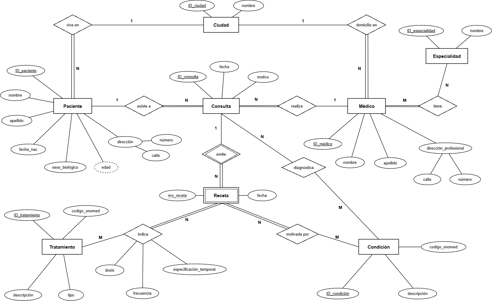

<p align="center"><i>Figura 1. Diagrama de Chen del modelo entidad-relación propuesto</i></p>

#### 2.1. Notación utilizada

En la notación de Chen, las entidades se representan mediante rectángulos, las relaciones mediante rombos y los atributos mediante óvalos conectados a la entidad o relación que describen. Las entidades débiles se representan con un rectángulo doble y se vinculan a la entidad de la que dependen mediante una relación identificadora, representada con un rombo doble. Su clave parcial se identifica con un subrayado punteado. Los atributos clave se identifican con su nombre subrayado. Los atributos compuestos se representan mediante un óvalo del que se desprenden los óvalos de sus componentes, y los atributos derivados mediante un óvalo de línea punteada. En cada relación se indica la cardinalidad (1, N o M), que expresa la cantidad máxima de instancias de una entidad que pueden asociarse con una instancia de la otra. Una línea doble representa participación total, es decir, que toda instancia de la entidad debe participar en la relación, y una línea simple representa participación parcial, es decir, que pueden existir instancias que no participen en ella.

#### 2.2. Entidades

**Paciente**

Representa a cada persona atendida en el centro de salud. Es una entidad fuerte identificada por el atributo clave ID_paciente. Se registran su nombre, apellido, fecha de nacimiento, sexo biológico y dirección. La dirección se modeló como un atributo compuesto formado por calle y número, ya que sus componentes pueden consultarse por separado. La ciudad, en cambio, no se incluyó como componente de la dirección, sino que se representó como una entidad independiente vinculada mediante la relación “vive en”. La edad se modeló como un atributo derivado, dado que puede calcularse a partir de la fecha de nacimiento, ya que almacenarla generaría un dato que se desactualiza con el paso del tiempo.

**Médico**

Representa a cada profesional del centro y se identifica mediante ID_médico. Se registran su nombre, apellido y dirección profesional, también modelada como atributo compuesto (calle y número), y su ciudad se vincula a la entidad Ciudad mediante la relación “domicilio en”. La especialidad no se representó como un atributo del médico, sino como una entidad propia, ya que un mismo profesional puede tener más de una.

**Consulta**

Representa cada atención realizada por un médico a un paciente. Es una entidad fuerte identificada por ID_consulta, con los atributos fecha y motivo. Se decidió registrar las recetas a partir de las consultas, considerando que las recetas relevantes para el sistema son las emitidas dentro del centro de salud en el marco de una atención.

**Receta**

Se modeló como una entidad débil dependiente de Consulta. Una receta no existe por fuera de la consulta en la que se emite y no puede identificarse por sí sola, su atributo nro_receta es una clave parcial que solo distingue a las recetas dentro de una misma consulta (por ejemplo, receta 1 y receta 2 de la consulta 57). Su identificación completa requiere, además, el identificador de la consulta. Por este motivo se representa con un rectángulo doble, se vincula a Consulta mediante la relación identificadora emite (rombo doble) y su clave parcial se subraya con línea punteada. Además de su número, cada receta registra su fecha de emisión.

**Tablas de referencia: Ciudad, Especialidad, Tratamiento y Condición**

Se incorporaron cuatro entidades fuertes que funcionan como catálogos de valores controlados. Su objetivo es evitar que un mismo concepto se registre con distintas escrituras, lo que afectaría la calidad de las búsquedas y del análisis estadístico. Por otro lado, tanto Tratamiento como Condición incluyen el atributo codigo_snomed, que almacena el código SNOMED CT del concepto. La incorporación de esta terminología estandarizada favorece la interoperabilidad con otros sistemas y módulos, y garantiza que conceptos equivalentes compartan un mismo código independientemente de cómo se los nombre. El código no se utilizó como clave, ya que podrían existir conceptos propios del centro sin código asignado y un eventual cambio de terminología no debería afectar la identificación de los registros.

#### 2.3. Relaciones, cardinalidad y participación

- vive en (Paciente – Ciudad, N:1). Cada paciente vive en una única ciudad y en una ciudad pueden vivir muchos pacientes. La participación de Paciente es total, ya que la ciudad forma parte de los datos obligatorios de la ficha, y la de Ciudad es parcial, porque pueden existir ciudades del catálogo sin pacientes registrados.
- domicilio en (Médico – Ciudad, N:1). Análogamente, cada médico tiene su domicilio profesional en una única ciudad, con participación total de Médico y parcial de Ciudad.
- asiste a (Paciente – Consulta, 1:N). Un paciente puede asistir a muchas consultas, pero cada consulta corresponde a un único paciente. La participación de Consulta es total, ya que no puede existir una consulta sin paciente, mientras que la de Paciente es parcial, dado que un paciente puede estar registrado en el sistema sin haber realizado aún ninguna consulta.
- realiza (Médico – Consulta, 1:N). Un médico puede realizar muchas consultas y cada consulta es realizada por un único médico. Nuevamente, la participación de Consulta es total y la de Médico es parcial, ya que un profesional recién incorporado puede no tener consultas registradas.
- tiene (Médico – Especialidad, M:N). Un médico puede tener varias especialidades y una especialidad puede ser ejercida por varios médicos. La participación de Médico es total, porque todo profesional del centro tiene al menos una especialidad; la de Especialidad es parcial, porque el catálogo puede incluir especialidades sin médicos asignados.
- emite (Consulta – Receta, 1:N, relación identificadora). En una consulta pueden emitirse varias recetas y cada receta corresponde a una única consulta. La participación de Receta es total, como corresponde a una entidad débil, y la de Consulta es parcial, ya que el enunciado indica que el médico puede emitir una receta, pero no está obligado a hacerlo.
- indica (Receta – Tratamiento, N:M). Una receta puede indicar varios tratamientos y un mismo tratamiento puede aparecer en muchas recetas. La participación de Receta es total, ya que toda receta indica al menos un tratamiento, y la de Tratamiento es parcial. Los atributos dosis, frecuencia y especificación_temporal se asignaron a esta relación y no a ninguna de las entidades. El motivo es que no describen al tratamiento en general ni a la receta en su conjunto, sino a una indicación concreta, ya que el mismo medicamento puede indicarse “por 5 días” en una receta y de “uso indefinido” en otra.
- motivada por (Receta – Condición, N:M). Registra la condición clínica que motivó cada prescripción, tal como requiere el enunciado. Es una relación muchos a muchos, ya que una receta puede responder a más de una condición y una misma condición puede motivar muchas recetas. La participación de Receta es total y la de Condición es parcial.
- diagnostica (Consulta – Condición, N:M). Registra las condiciones diagnosticadas durante una consulta, independientemente de que se emita o no una receta. La participación es parcial en ambos extremos: puede haber consultas sin diagnóstico registrado (por ejemplo, controles de rutina) y condiciones del catálogo que nunca fueron diagnosticadas. Esta relación se incorporó para no perder diagnósticos que no generan una indicación inmediata, y por lo tanto preservar información necesaria para el seguimiento epidemiológico que plantea el enunciado. De esta manera, se diferencia lo que el médico diagnosticó en la consulta de la condición que motivó una prescripción particular.

Por otro lado, cabe aclarar que el modelo entidad-relación no permite expresar todas las reglas del dominio. En particular, la condición que motiva una receta debería encontrarse entre las condiciones diagnosticadas en la consulta que la originó. Esta restricción no puede representarse en la notación de Chen y deberá garantizarse mediante la lógica de la aplicación o mediante restricciones adicionales en el sistema de gestión de la base de datos.

### 3. Modelo Relacional (Diagrama de Crow’s Foot)

A partir del modelo conceptual desarrollado en el punto anterior, se realizó el mapeo al modelo relacional, aplicando las reglas de transformación de entidades, atributos y relaciones vistas en clase. El objetivo fue representar la información mediante tablas interrelacionadas, identificadas por claves primarias (PK) y vinculadas mediante claves foráneas (FK), conservando las restricciones de cardinalidad y participación definidas en el modelo conceptual. El resultado se presenta en la Figura 2 mediante un diagrama en notación Crow’s Foot.

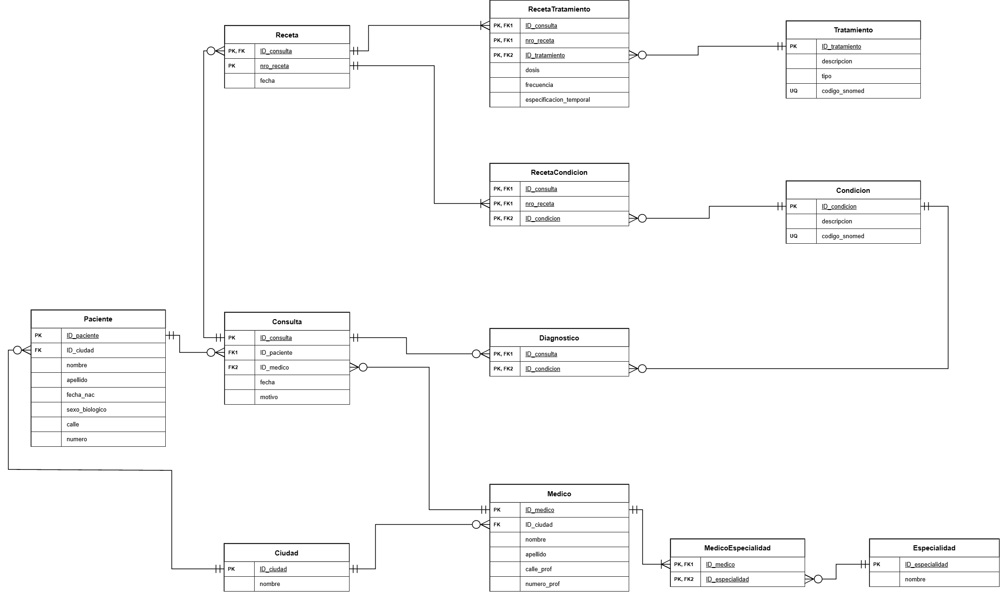

<p align="center"><i>Figura 2. Diagrama de Crow’s Foot del modelo relacional propuesto</i></p>

#### 3.1. Notación utilizada

En el diagrama, cada tabla se representa mediante un recuadro que contiene su nombre y sus atributos, identificando las claves primarias (PK), las claves foráneas (FK) y las restricciones de unicidad (UQ) cuando corresponden. Las relaciones entre las tablas se representan mediante líneas, en cuyos extremos se utilizan símbolos que indican la cantidad mínima y máxima de registros que pueden asociarse. En cada extremo se utilizan dos símbolos que, en conjunto, indican la cantidad mínima y máxima de registros que pueden asociarse con un registro de la tabla opuesta. El círculo (○) representa una participación opcional (mínimo cero), la línea vertical (|) representa uno y la pata de gallo (<) representa muchos. A partir de su combinación, se distinguen las cardinalidades utilizadas en el modelo como cero o uno (○ |), uno y solo uno (| |), cero o muchos (○<) y uno o muchos (|<). Estas cardinalidades permiten conservar las restricciones de participación establecidas en el diagrama de Chen.

#### 3.2. Proceso de mapeo

Para obtener el modelo relacional, las entidades fuertes se transformaron en tablas independientes, utilizando sus atributos identificadores como claves primarias. Este procedimiento dio origen a las tablas Paciente, Medico, Consulta, Ciudad, Especialidad, Tratamiento y Condición. La entidad débil Receta se transformó en una tabla con clave primaria compuesta, formada por el identificador de la consulta de la que depende (ID_consulta) y su clave parcial (nro_receta). En cuanto a los atributos compuestos, las direcciones de Paciente y Médico se descompusieron en calle y número, mientras que la ciudad se representó mediante una referencia a la tabla Ciudad. La edad del paciente, al ser un atributo derivado, no se almacenó, ya que puede calcularse a partir de la fecha de nacimiento. Las relaciones uno a muchos (1:N) se implementaron incorporando la clave primaria de la entidad del lado 1, como clave foránea en la tabla del lado N. Por ejemplo, Consulta contiene ID_paciente e ID_medico, que permiten identificar al paciente atendido y al médico que realizó cada consulta. Por su parte, las relaciones muchos a muchos (M:N) requirieron la creación de tablas intermedias, cuyas claves primarias están formadas por las claves foráneas de las entidades relacionadas. De esta manera, se obtuvieron MedicoEspecialidad, RecetaTratamiento, RecetaCondicion y Diagnostico.

#### 3.3. Descripción de las tablas

**Paciente**

Almacena la información personal de cada paciente, identificado de manera única mediante ID_paciente (PK). Contiene nombre, apellido, fecha de nacimiento, sexo biológico y los componentes de su dirección. La columna ID_ciudad es una clave foránea que referencia a Ciudad. En la propuesta de implementación, todos los atributos del paciente son obligatorio (NOT NULL). La edad no se incluye como columna, ya que se obtiene a partir de fecha_nac, evitando almacenar un dato que cambia con el tiempo.

**Médico**

Registra los datos de cada profesional, identificado mediante ID_medico (PK). Incluye nombre, apellido y los componentes de su dirección profesional, además de ID_ciudad (FK), que referencia la ciudad de dicho domicilio. La especialidad no se almacena directamente como atributo de Médico, sino que se vincula a través de MedicoEspecialidad. Esto permite que un mismo profesional posea varias especialidades sin almacenar múltiples valores en una única columna. De manera similar a Paciente, los datos identificatorios se consideran obligatorios.

**Ciudad y Especialidad**

Las tablas Ciudad y Especialidad funcionan como catálogos de referencia, cuyos valores se encuentran previamente definidos. Al registrar un paciente o médico, se selecciona un valor existente del catálogo en lugar de ingresarlo como texto libre, evitando diferencias de escritura y facilitando el análisis estadístico.

**Consulta**

Representa cada atención realizada a un paciente por un médico. Se identifica mediante ID_consulta (PK) e incorpora ID_paciente e ID_medico como claves foráneas hacia sus respectivas tablas. Ambas claves foráneas son obligatorias (NOT NULL), ya que toda consulta debe estar asociada a un paciente y a un médico existentes. La fecha de atención también se considera obligatoria, dado que permite llevar un registro cronológico de las consultas y realizar el seguimiento clínico de los pacientes. Del mismo modo, el motivo de consulta se define como NOT NULL, ya que permite documentar la razón por la que se realizó la atención, asegurando que cada consulta cuente con la información clínica mínima necesaria para su posterior seguimiento e interpretación. Por último, los datos personales del paciente y del médico no se almacenan nuevamente en Consulta, ya que pueden obtenerse mediante sus claves foráneas. Esto evita la duplicación de información y posibles inconsistencias al actualizar los datos de cualquiera de ellos.

**Receta**

Corresponde a la entidad débil identificada en el modelo conceptual. Su clave primaria es compuesta por (ID_consulta, nro_receta), donde ID_consulta funciona simultáneamente como clave foránea hacia Consulta. Esta estructura permite que distintas consultas tengan una receta con el mismo número interno, sin generar ambigüedad, ya que la identificación completa depende de ambos atributos. Ninguno de los componentes de la clave primaria puede admitir valores nulos. La fecha de emisión también se considera obligatoria.

**Tratamiento**

Constituye un catálogo de los medicamentos y demás indicaciones que pueden prescribirse, como reposo o fisioterapia. Cada tratamiento se identifica mediante ID_tratamiento (PK), y posee una descripción, un tipo y un código SNOMED CT. La descripción y el tipo se consideran obligatorios, mientras que codigo_snomed puede admitir NULL para aquellos tratamientos que no tengan un código asignado. Sobre este último atributo se estableció una restricción UNIQUE, con el objetivo de impedir que un mismo código SNOMED CT se asigne a distintos tratamientos del catálogo.

**Condición**

Almacena las enfermedades o condiciones clínicas que pueden diagnosticarse o motivar una prescripción. Cada registro posee un identificador propio (ID_condicion, PK), una descripción y un código SNOMED CT. Al igual que en Tratamiento, la descripción es obligatoria y el código SNOMED admite valores nulos, pero debe ser único entre los registros que poseen uno. Esta organización permite utilizar conceptos clínicos controlados para realizar estadísticas y seguimiento epidemiológico, evitando depender exclusivamente de descripciones escritas en texto libre.

**MedicoEspecialidad**

Es la tabla intermedia que implementa la relación M:N entre Medico y Especialidad. Su clave primaria compuesta está formada por (ID_medico, ID_especialidad), y ambos atributos también son claves foráneas hacia sus respectivas tablas. Esta estructura permite asociar múltiples especialidades a un médico y múltiples médicos a una especialidad. La combinación de ambas claves impide registrar dos veces una misma asociación.

**RecetaTratamiento**

Implementa la relación M:N entre Receta y Tratamiento. Se identifica mediante la clave primaria compuesta (ID_consulta, nro_receta, ID_tratamiento). Los atributos ID_consulta y nro_receta conforman conjuntamente una clave foránea compuesta hacia Receta, mientras que ID_tratamiento referencia a Tratamiento. Además, incorpora los atributos dosis, frecuencia y especificacion_temporal, que en el modelo conceptual pertenecían a la relación indica. Estos describen las características de una prescripción particular y no al tratamiento del catálogo en general. Además, estos atributos pueden admitir valores nulos (NULL), dado que no todas las indicaciones requieren especificar estos datos.

**RecetaCondicion**

Representa la relación M:N entre Receta y Condicion y permite registrar las condiciones clínicas que motivaron cada prescripción. Su clave primaria está formada por (ID_consulta, nro_receta, ID_condicion). Los dos primeros atributos constituyen una clave foránea compuesta hacia Receta, mientras que ID_condicion referencia a Condicion. Esto permite asociar una receta a más de una condición clínica sin repetir la información completa de la receta.

**Diagnóstico**

Es la tabla intermedia que implementa la relación M:N entre Consulta y Condicion. Contiene una clave primaria compuesta por (ID_consulta, ID_condicion), cuyos componentes también son claves foráneas. Permite registrar las condiciones diagnosticadas durante cada consulta, independientemente de que se emita una receta. De esta forma, se diferencia la información diagnóstica obtenida durante la atención, de las condiciones que motivan una prescripción particular. Esta separación permite conservar diagnósticos que no requieren tratamiento inmediato y utilizarlos para el seguimiento epidemiológico.

#### 3.4. Cardinalidades, nulabilidad y restricciones de integridad

En el modelo relacional, las cardinalidades establecidas en el diagrama conceptual se reflejan mediante la ubicación de las claves foráneas y las restricciones de participación. Por ejemplo, un paciente puede estar registrado sin haber realizado consultas, pero toda consulta debe corresponder a un paciente existente. Por lo tanto, la participación opcional de Paciente se representa mediante la posibilidad de que no tenga registros asociados en Consulta, mientras que la obligatoriedad de Consulta se expresa mediante una clave foránea ID_paciente que no admite NULL. De manera similar, una consulta puede no emitir recetas, pero toda receta debe estar asociada a una consulta existente. En las tablas intermedias, todos los atributos que forman las claves primarias compuestas son obligatorios. Aunque una entidad del catálogo pueda no participar en ninguna relación, cada fila que efectivamente se registre en una tabla intermedia debe referenciar entidades existentes. La integridad referencial se garantiza mediante las claves foráneas, evitando asociaciones con registros inexistentes. Por otra parte, la restricción de integridad de entidad establece que las claves primarias deben ser únicas y no admitir valores nulos. Se incorporaron también restricciones de unicidad (UQ), especialmente en los códigos SNOMED CT de Tratamiento y Condicion. Estos códigos no se utilizaron como claves primarias, ya que pueden existir conceptos sin código asignado. En consecuencia, se mantienen identificadores internos para cada registro y el código SNOMED se utiliza como atributo opcional de identificación terminológica. Finalmente, ciertas restricciones del modelo conceptual no pueden garantizarse únicamente mediante claves foráneas. Por ejemplo, asegurar que todo médico tenga al menos una especialidad, o que toda receta tenga al menos un tratamiento y una condición asociada, requiere controles adicionales en el gestor de bases de datos o en la aplicación.

#### 3.5. Consideraciones sobre la normalización

El modelo relacional se diseñó buscando reducir la redundancia, mantener la consistencia y evitar anomalías de inserción, actualización y eliminación. Considerando las dependencias funcionales asumidas para las entidades y relaciones, el esquema propuesto puede justificarse hasta la tercera forma normal (3FN).

I. Primera forma normal (1FN). Cada tabla contiene atributos de valor único y atómico, sin almacenar listas de valores dentro de una misma columna. Por ejemplo, las distintas especialidades de un médico no se guardan como una lista en Medico, sino mediante filas independientes en MedicoEspecialidad. De la misma manera, los tratamientos y las condiciones asociados a una receta se representan mediante tablas intermedias.

II. Segunda forma normal (2FN). Para cumplir la segunda forma normal, una tabla debe estar en primera forma normal y todos los atributos que no forman parte de su clave deben depender de la clave primaria completa, y no solamente de una parte de ella. Por ejemplo, en la tabla RecetaTratamiento, la clave primaria está formada por ID_consulta, nro_receta e ID_tratamiento. Esta combinación permite identificar qué tratamiento fue indicado en una receta determinada. Los atributos dosis, frecuencia y especificación temporal dependen de esa combinación completa, porque un mismo tratamiento puede indicarse de distintas maneras en diferentes recetas, y una receta puede contener varios tratamientos con indicaciones diferentes.

III. Tercera forma normal (3FN). El modelo evita almacenar atributos no clave que dependan transitivamente de otros atributos no clave. Por ejemplo, el nombre y los datos personales del paciente no se repiten en Consulta ni en Receta, sino que se recuperan mediante las relaciones correspondientes. Del mismo modo, la descripción de una especialidad se conserva en Especialidad, la de un tratamiento en Tratamiento y el nombre de la ciudad en Ciudad, en lugar de repetir estos valores en todas las tablas relacionadas.

Estas decisiones reducen las anomalías de actualización, ya que modificar la información de una entidad no requiere actualizar múltiples registros que contienen copias del mismo dato. Por lo tanto, bajo las reglas de identificación y dependencias funcionales definidas para este sistema, no se identifican violaciones a 1FN, 2FN o 3FN. No obstante, el cumplimiento de formas normales superiores requeriría un análisis adicional de las dependencias funcionales y multivaluadas del dominio. En conjunto, el mapeo realizado permite representar de manera consistente la información del centro de salud, conservando las relaciones del modelo conceptual y facilitando tanto el registro de las operaciones clínicas como su posterior recuperación y análisis.

### 4. Errores de Normalización

#### 4.1. Caso 1

La Tabla 1 viola la primera forma normal (1FN). Según su definición, una tabla está en 1FN si cada celda contiene un único valor primitivo (no se admiten listas, arreglos, JSON ni otras estructuras compuestas), todas las filas tienen el mismo número de columnas, existe una clave primaria que identifica a cada fila y no hay columnas diferentes que almacenen el mismo tipo de dato. En este caso, la columna Teléfonos almacena más de un valor en una misma celda (por ejemplo, “1111, 2222” para la paciente Ana), lo que incumple el requisito de atomicidad. Este diseño impide buscar, modificar o eliminar un teléfono en particular sin manipular el texto completo, y no permite controlar el formato de cada número por separado.

<p align="center"><b>PacienteInfo</b></p> <div align="center"> <table> <tr><th>PacienteID(Pk)</th><th>Nombre</th><th>Teléfonos</th></tr> <tr><td>1</td><td>Ana</td><td>1111, 2222</td></tr> <tr><td>2</td><td>Juan</td><td>3333</td></tr> </table> </div> <p align="center"><i>Tabla 1. Tabla “Paciente Info”, viola la 1FN.</i></p>

#### 4.2. Caso 2

En este caso, la Tabla 2 cumple la 1FN y la 2FN pero viola la tercera forma normal (3FN) porque presenta una dependencia transitiva (PacienteID → Ciudad → CódigoPostal). El código postal no depende del paciente sino de la ciudad, es decir, de otro atributo no clave. En consecuencia, el código postal de una ciudad se repite en cada paciente que vive en ella, lo que genera redundancia y riesgo de inconsistencias: si se modifica el dato en un registro y no en los demás, una misma ciudad queda asociada a distintos códigos.

<p align="center"><b>PacienteInfo</b></p> <div align="center"> <table> <tr><th>PacienteID(Pk)</th><th>Ciudad</th><th>CódigoPostal</th></tr> <tr><td>1</td><td>CABA</td><td>1000</td></tr> <tr><td>2</td><td>La Plata</td><td>1900</td></tr> </table> </div> <p align="center"><i>Tabla 2. Tabla “Paciente Info”, viola la 3FN.</i></p>

#### 4.3. Caso 3

La Tabla 3 viola la segunda forma normal (2FN), ya que contiene atributos que dependen solo de una parte de su clave primaria compuesta (PacienteID, MédicoID). El atributo NombrePaciente depende únicamente de PacienteID, porque el nombre del paciente es el mismo independientemente del médico que lo atienda, y el atributo Especialidad depende únicamente de MédicoID, porque es una característica del médico y no de la atención. Estas dependencias parciales generan redundancia, ya que el nombre de un paciente se repite tantas veces como médicos lo atiendan, y la especialidad de un médico, tantas veces como pacientes atienda.

<p align="center"><b>AtencionPacienteMedico</b></p> <div align="center"> <table> <tr><th>PacienteID(Pk)</th><th>MédicoID(Pk)</th><th>NombrePaciente</th><th>Especialidad</th></tr> <tr><td>1</td><td>10</td><td>Ana</td><td>Pediatría</td></tr> <tr><td>2</td><td>20</td><td>Juan</td><td>Cardiología</td></tr> </table> </div> <p align="center"><i>Tabla 3. Tabla “AtencionPacienteMedico”, viola la 2FN.</i></p>

#### 4.4. Caso 4

La Tabla 4 viola la cuarta forma normal (4FN). El motivo es que presenta dos dependencias multivaluadas independientes entre sí, con PacienteID y Enfermedad, y PacienteID y Medicamento. Como la tabla no establece qué medicamento se indicó para cada enfermedad, se deben registrar todas las combinaciones posibles, resultando en cuatro filas a partir de dos enfermedades y dos medicamentos. Esto produce redundancia y combinaciones artificiales, ya que, por ejemplo, la fila “Diabetes – Ibuprofeno” sugiere un vínculo entre ambos datos que no necesariamente existe. Además, agregar un nuevo medicamento obliga a insertar una fila por cada enfermedad del paciente.

<p align="center"><b>ConsultasPaciente</b></p> <div align="center"> <table> <tr><th>PacienteID</th><th>Enfermedad</th><th>Medicamento</th></tr> <tr><td>1</td><td>Gripe</td><td>Paracetamol</td></tr> <tr><td>1</td><td>Gripe</td><td>Ibuprofeno</td></tr> <tr><td>1</td><td>Diabetes</td><td>Paracetamol</td></tr> <tr><td>1</td><td>Diabetes</td><td>Ibuprofeno</td></tr> </table> </div> <p align="center"><i>Tabla 4. Tabla “ConsultasPaciente”, viola la 4FN.</i></p>

## Actividad 2

Para realizar la actividad 2 se utilizó la base de datos provista por la cátedra base_de_datos.sql, un modelo simplificado del funcionamiento de un centro de salud que se compone de siete tablas: SexoBiologico y Especialidades funcionan como tablas de referencia, mientras que Pacientes y Medicos almacenan los datos de las personas, luego Consultas registra cada atención con su fecha, diagnóstico y código SNOMED CT, Medicamentos actúa como catálogo de indicaciones y finalmente Recetas vincula a un médico, un paciente y un medicamento en una fecha determinada. Las relaciones entre tablas se implementan mediante claves foráneas, donde cada paciente referencia su sexo biológico, cada médico su especialidad (pudiendo ser nula) y tanto las consultas como las recetas referencian al paciente y al médico involucrados. Para resolver las consignas se instaló PostgreSQL de manera local y se trabajó desde Visual Studio Code con la extensión oficial de PostgreSQL para evitar tener problema con las limitaciones de consultas de la versión online. Las queries se encuentran en el repositorio de GitHub creado, el cual se puede acceder desde el siguiente link [Repo TP4 (G5)](https://github.com/natasha121103/InfoMed_TP4_Grupo5).

### Consigna 1

A fin de optimizar los tiempos de respuestas de las consultas se creó un índice sobre la columna ciudad de la tabla Pacientes mediante CREATE INDEX. El índice no modifica el modelo relacional ni los datos almacenados, sino que forma parte del diseño físico de la base, y es el propio motor el que decide cuándo utilizarlo. Su beneficio se aprecia en tablas con un gran volumen de registros y en consultas que trabajan sobre una parte de ellos, por lo que con los 35 pacientes de esta base la diferencia resulta imperceptible.

```sql
CREATE INDEX idx_pacientes_ciudad
ON Pacientes (ciudad);

-- No hay forma de visualizar (que sepamos)
```


### Consigna 2

Dado que la edad es un dato que cambia con el tiempo, almacenarla como una columna fija haría que quedara desactualizada en cuanto un paciente cumpliera años. Por ese motivo se optó por crear una vista llamada vista_pacientes_edad, que permite recalcular la edad del paciente cada vez que se consulta el mismo. En este query se utilizó la función AGE que obtiene el intervalo transcurrido entre la fecha de nacimiento y la fecha actual, y la función EXTRACT para tomar únicamente cantidad de años de ese intervalo. La vista incluye, además de la edad, el identificador, el nombre, la fecha de nacimiento, el sexo y la dirección del paciente, de modo que pueda reutilizarse en consignas posteriores.

```sql
CREATE VIEW vista_pacientes_edad AS
SELECT
   p.id_paciente,
   p.nombre,
   p.fecha_nacimiento,
   EXTRACT(YEAR FROM AGE(p.fecha_nacimiento)) AS edad,
   p.id_sexo,
   p.numero,
   p.calle,
   p.ciudad
FROM Pacientes p;

-- En otro query debería poner lo siguiente para ver que me da el query 2
-- SELECT * FROM vista_pacientes_edad
```

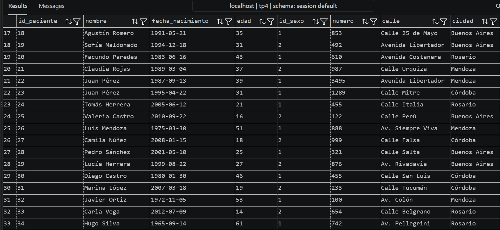

### Consigna 3

Para obtener a los pacientes menores de edad se consultó la vista creada en la consigna anterior, seleccionando el nombre y la edad y filtrando con la condición edad < 18. Al utilizar la vista no fue necesario repetir el cálculo de la edad, además, es importante notar que el resultado puede variar con el tiempo, en la fecha de ejecución (12/10/2026) se obtuvieron dos pacientes: Valeria Castro y Carla Vega.

```sql
SELECT nombre, edad
FROM vista_pacientes_edad
WHERE edad < 18;
```

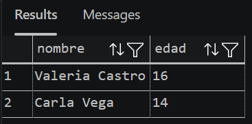

### Consigna 4

Para actualizar la dirección de Luciana Gómez se utilizó la sentencia UPDATE, modificando los valores de la calle, el número y ciudad mediante SET y restringiendo el cambio a la paciente correspondiente mediante la cláusula WHERE. La consulta afectó a un único registro, lo que se verificó consultando nuevamente la tabla.

```sql
UPDATE Pacientes
SET calle = 'Calle Corrientes',
    numero = '500',
    ciudad = 'Buenos Aires'
WHERE nombre = 'Luciana Gómez'
  AND calle = 'Avenida Las Heras'
  AND numero = '121'
  AND TRIM(ciudad) ILIKE 'b%s';

-- Para comprobar que se hizo bien
-- SELECT * 
-- FROM Pacientes
-- WHERE nombre = 'Luciana Gómez'
--      AND calle = 'Calle Corrientes'
--      numero = '500',
--      ciudad = 'Buenos Aires';
```

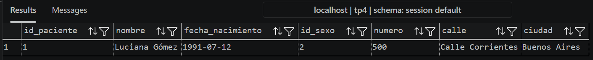

### Consigna 5

Con el objetivo de obtener a todos los pacientes que viven en Buenos Aires se tuvo que tener en cuenta que la ciudad aparece escrita de distintas formas en la base, por ser un atributo de texto libre. Por eso, en lugar de una comparación exacta, se utilizó el operador ILIKE, que compara textos sin distinguir mayúsculas de minúsculas, junto con %, que representa cualquier secuencia de caracteres. Además, se aplicó la función TRIM para eliminar los espacios en blanco al principio y al final del texto antes de comparar. Específicamente se utilizó el patrón b%s, que selecciona las ciudades que comienzan con "b" y terminan con "s", sin tener en cuenta si cuenta con espacio en medio, lo que permite reunir todas las variantes presentes en la base ("Bs Aires", "buenos aires", "Buenos Aires", "Buenos Aiers", entre otras) y dando un resultado de 11 pacientes. Es importante notar que de esta forma se puede trabajar sin importar las inconsistencias, pero que no las corrige. Por otro lado, el patrón utilizado solo sirve para bases de datos, como la presente, que no cuentan con ciudades alternativas que inicien en “b” y terminen en “s”.

```sql
SELECT id_paciente, nombre, numero, calle, ciudad 
FROM Pacientes
WHERE TRIM(ciudad) ILIKE 'b%s';

-- ILIKE no le importa mayúscula o minúscula
-- TRIM saca los espacios de los extremos
```

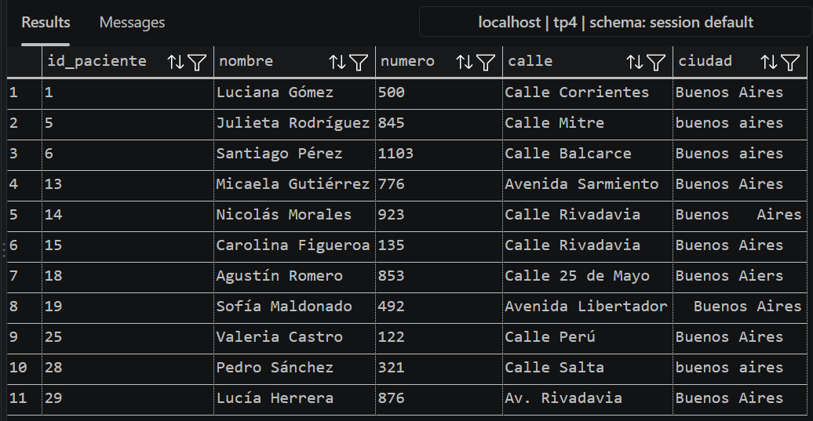

### Consigna 6

En este punto se buscó corregir las inconsistencias en los nombres de las ciudades, para ello se utilizó la sentencia UPDATE combinada con una expresión CASE, que evalúa cada ciudad y le asigna el nombre normalizado correspondiente. Cada condición WHEN utiliza TRIM y patrones con LIKE o ILIKE para reconocer todas las variantes de una misma ciudad (por ejemplo, `'C%ba'` agrupa "Cordoba", "Córdoba" y "Córodba"), y la cláusula ELSE devuelve la ciudad sin espacios sobrantes para los casos que no requieren otra corrección, como Santa Fe. Los patrones se construyeron a partir de las variantes efectivamente presentes en la base, por lo que ante nuevos datos podrían ser necesarias condiciones adicionales. A largo plazo, la solución definitiva sería reemplazar el texto libre por una tabla de referencia de ciudades, como se propuso en el modelo de la Parte 1.

```sql
UPDATE Pacientes
SET ciudad = CASE
    WHEN TRIM(ciudad) ILIKE 'b%s' THEN 'Buenos Aires'
    WHEN TRIM(ciudad) ILIKE 'rosario' THEN 'Rosario'
    WHEN TRIM(ciudad) LIKE 'Men%' THEN 'Mendoza'
    WHEN TRIM(ciudad) ILIKE 'C%ba' THEN 'Córdoba'
    ELSE TRIM(ciudad)
END;
```

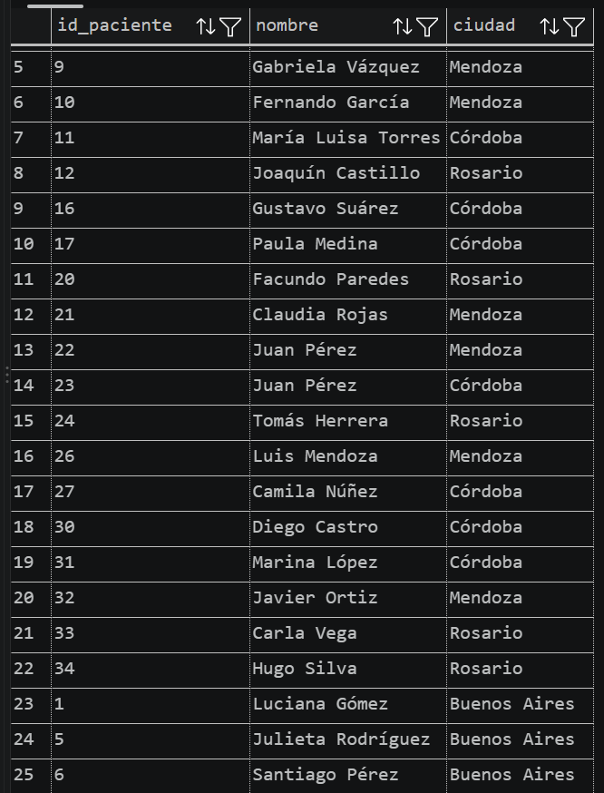

### Consigna 7

Para obtener la cantidad de pacientes por sexo en cada ciudad se agruparon los pacientes por ciudad con GROUP BY y se calcularon dos conteos mediante COUNT(*) FILTER, que cuenta únicamente las filas que cumplen una condición: uno para los pacientes con id_sexo = 1 y otro para los pacientes con id_sexo = 2. Según la tabla SexoBiologico, estos valores corresponden a "Masculino" y "Femenino", respectivamente, y así se nombraron las columnas del resultado. Como esta consulta se ejecutó después de la consigna

6, el resultado muestra las cinco ciudades ya normalizadas, con una fila por ciudad y una columna para cada sexo.

```sql
SELECT ciudad,
    COUNT(*) FILTER (WHERE id_sexo = 1) AS "Masculino",
    COUNT(*) FILTER (WHERE id_sexo = 2) AS "Femenino"
FROM Pacientes
GROUP BY ciudad;

-- FILTER es una cláusula que permite aplicar condiciones 
-- a las funciones de agregación (ej. COUNT).
```

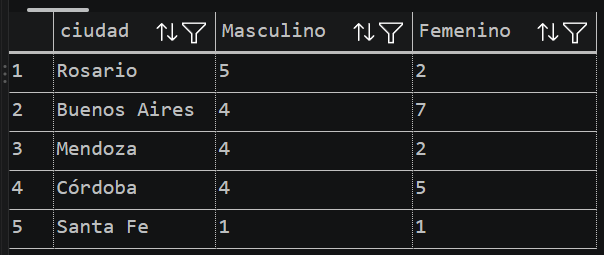

### Consigna 8

A fin de obtener las consultas realizadas por el médico con id_medico = 3 durante agosto de 2024 se filtró la tabla Consultas combinando tres condiciones con el operador AND, lo que permitió identificar que el médico sea el 3, que el año de la fecha sea 2024 y que el mes sea 8. El año y el mes se obtuvieron con la función EXTRACT. La consulta devolvió tres consultas.

```sql
SELECT *
FROM Consultas
WHERE id_medico = 3 AND EXTRACT(YEAR FROM (fecha)) = 2024 
                    AND EXTRACT(MONTH FROM (fecha)) = 8;
```

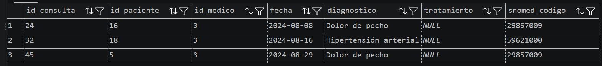

### Consigna 9

Para obtener la cantidad de recetas emitidas por cada médico se partió de la tabla Medicos y se realizó un LEFT JOIN con Recetas, relacionando ambas tablas mediante id_medico, esto para incluir a todos los médicos registrados, incluso a aquellos que todavía no emitieron ninguna receta. Luego, mediante GROUP BY, se agruparon los registros por médico y se utilizó COUNT(Recetas.id_receta) para contar las recetas correspondientes a cada uno. Finalmente, los resultados se ordenaron de mayor a menor según la cantidad de recetas emitidas con un ORDER BY. La consulta incluye a los 24 médicos de la base.

```sql
SELECT 
    Medicos.id_medico,
    Medicos.nombre,
    COUNT(Recetas.id_receta) AS cantidad_recetas
FROM Medicos
LEFT JOIN Recetas ON Medicos.id_medico = Recetas.id_medico
GROUP BY Medicos.id_medico
ORDER BY cantidad_recetas DESC;
```

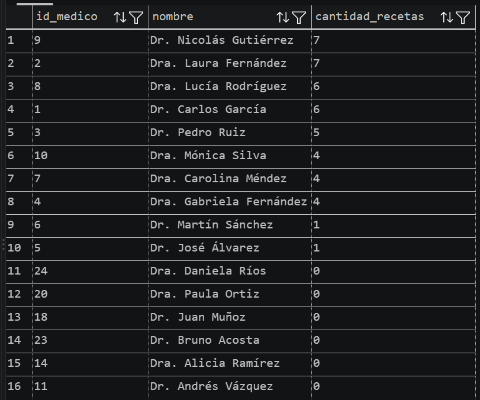

### Consigna 10

Al reutilizar el filtro por año y mes realizado en la consigna 8 y el uso de INNER JOIN para unir las tablas Consultas y Pacientes, se pudo obtener el nombre de los pacientes junto con la fecha y el diagnóstico de las consultas realizadas en agosto de 2024. Como esta consulta no agrupa registros, cada consulta médica aparece en una fila propia, por lo que un mismo paciente puede figurar más de una vez. Así, se obtuvieron 33 consultas, ordenadas por identificador de paciente.

```sql
SELECT 
    Pacientes.id_paciente,
    Pacientes.nombre,
    Consultas.fecha,
    Consultas.diagnostico
FROM Consultas
INNER JOIN Pacientes ON Pacientes.id_paciente = Consultas.id_paciente
WHERE EXTRACT(YEAR FROM (Consultas.fecha)) = 2024 AND EXTRACT(MONTH FROM (Consultas.fecha)) = 8
ORDER BY Pacientes.id_paciente ASC;

-- Unimos las tablas con el id de los pacientes para asegurar que sean pacientes distintos 
-- y no dos con un mismo nombre
```

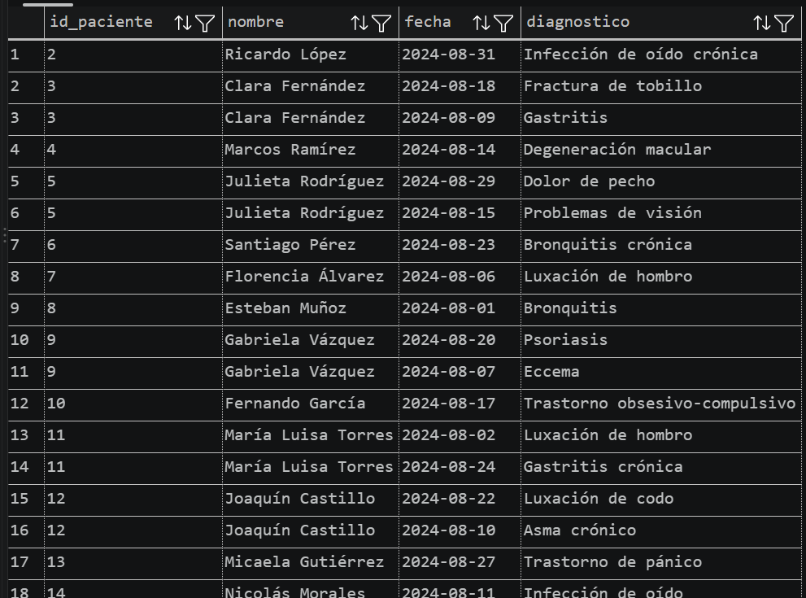

### Consigna 11

Para obtener los medicamentos prescritos más de una vez por el médico con id_medico = 2 se unieron las tablas Recetas y Medicamentos, se filtraron con WHERE las recetas emitidas por ese médico y se agruparon por nombre de medicamento. La condición sobre la cantidad de recetas se expresó con HAVING, teniendo como condición > 1, ya que WHERE filtra filas individuales antes de agrupar, mientras que HAVING filtra los grupos una vez realizado el conteo. El único medicamento que cumple la condición es el Omeprazol, recetado cuatro veces.

```sql
SELECT Medicamentos.nombre,
    COUNT(Recetas.id_medicamento) AS "Cant_Recetas"
FROM Recetas
INNER JOIN Medicamentos ON Medicamentos.id_medicamento = Recetas.id_medicamento
WHERE Recetas.id_medico = 2
GROUP BY Medicamentos.nombre
HAVING COUNT(Recetas.id_medicamento) > 1;
```

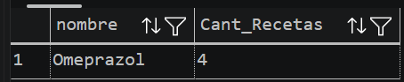

### Consigna 12

Para obtener la cantidad total de recetas recibidas por cada paciente se partió de la tabla Pacientes y se realizó un LEFT JOIN con Recetas mediante id_paciente. El uso de LEFT JOIN permite conservar a todos los pacientes registrados, incluidos aquellos que nunca recibieron una receta. Posteriormente, se agruparon los registros por identificador y nombre del paciente, y se aplicó COUNT(Recetas.id_receta) para calcular la cantidad de recetas correspondiente a cada uno. Al contar el identificador de la receta, los pacientes sin recetas reciben un valor de cero, ya que COUNT no considera los valores NULL. Por último, los resultados se ordenaron de mayor a menor cantidad de recetas. La consulta devuelve los 35 pacientes registrados en la base.

```sql
SELECT
    Pacientes.nombre,
    COUNT(Recetas.id_receta) AS cantidad_recetas
FROM Pacientes
LEFT JOIN Recetas ON Pacientes.id_paciente = Recetas.id_paciente
GROUP BY Pacientes.id_paciente, Pacientes.nombre
ORDER BY cantidad_recetas DESC;
```

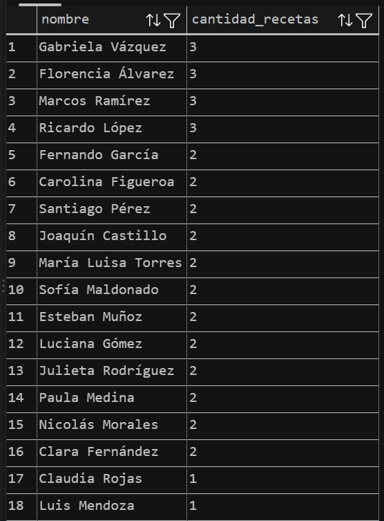

### Consigna 13

Se pueden conocer las especialidades que cuentan con más de dos médicos al unir la tabla Medicos con la tabla Especialidades. De esta forma se pueden agrupar a los médicos por especialidad para contabilizarlos con COUNT. Al igual que en la consigna 11, la condición sobre el conteo se expresó con HAVING, ya que depende del resultado del agrupamiento, en este caso COUNT(m.especialidad_id) > 2. Cumplen la condición cuatro especialidades: Cardiología, con cuatro médicos, y Clínica General, Dermatología y Pediatría, con tres médicos cada una.

```sql
SELECT e.id_especialidad,
    e.nombre,
    COUNT(m.especialidad_id) AS "Cantidad Med"
FROM Medicos m
INNER JOIN Especialidades e ON e.id_especialidad = m.especialidad_id
GROUP BY e.id_especialidad, e.nombre
HAVING COUNT(m.especialidad_id) > 2
```

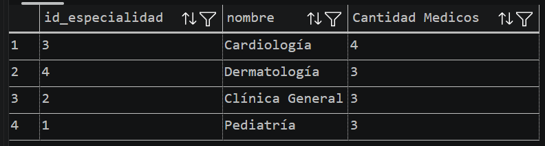

### Consigna 14

En este query se utilizó nuevamente la vista de la consigna 2, pero ahora combinada con la función AVG. Al ser necesario que la función tenga acceso al dato de la edad de todos los pacientes se optó por hacer una subconsulta dentro de WHERE, que se ejecuta primero y devuelve un único valor (35,6 años al momento de la ejecución) y luego la consulta principal compara la edad de cada paciente contra ese valor. El resultado, ordenado de mayor a menor edad con ORDER BY edad DESC, incluye 18 pacientes.

```sql
SELECT nombre, edad
FROM vista_pacientes_edad -- vista creada en consigna 2
WHERE edad > (SELECT AVG(edad) FROM vista_pacientes_edad) -- Subconsulta
ORDER BY edad DESC;
```

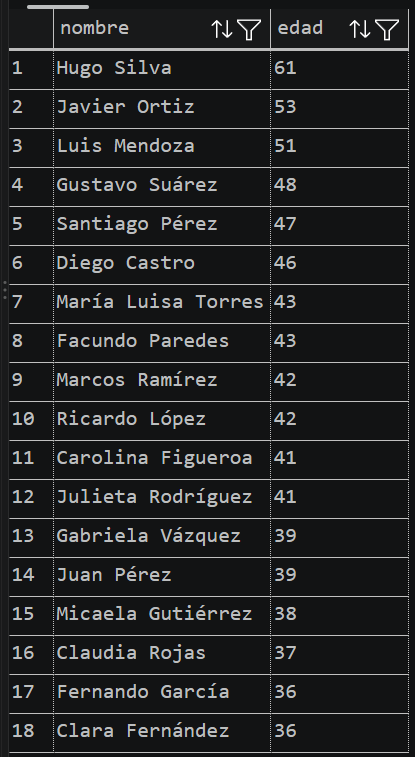

### Consigna 15

Para identificar los medicamentos que ocupan las dos primeras posiciones según la cantidad de recetas emitidas, se utilizó una expresión WITH que calcula inicialmente la cantidad de recetas correspondiente a cada medicamento. En la consulta principal se seleccionan los medicamentos cuya cantidad de recetas pertenece a los dos valores más altos obtenidos en el conteo. Para identificar esos valores se utiliza una subconsulta con SELECT DISTINCT, ORDER BY cantidad_recetas DESC y LIMIT 2. DISTINCT permite eliminar los conteos repetidos, de manera que LIMIT seleccione las dos cantidades más altas diferentes, en lugar de seleccionar solamente dos medicamentos. Posteriormente, el operador IN permite conservar todos los medicamentos cuya cantidad de recetas coincida con alguno de esos dos valores. De esta manera, también se incluyen los medicamentos empatados. En la base utilizada, la Férula ocupa la primera posición con cinco recetas, mientras que seis medicamentos comparten la segunda posición con cuatro recetas cada uno, por lo que el resultado contiene siete medicamentos.

```sql
WITH cantidad_medicamentos AS (
    SELECT m.id_medicamento, m.nombre, COUNT(r.id_receta) AS cantidad_recetas
    FROM Medicamentos m
    LEFT JOIN Recetas r ON m.id_medicamento = r.id_medicamento
    GROUP BY m.id_medicamento, m.nombre
)


SELECT nombre, cantidad_recetas
FROM cantidad_medicamentos
WHERE cantidad_recetas IN (
    SELECT DISTINCT cantidad_recetas
    FROM cantidad_medicamentos
    ORDER BY cantidad_recetas DESC
    LIMIT 2
)
ORDER BY cantidad_recetas DESC, nombre;
```

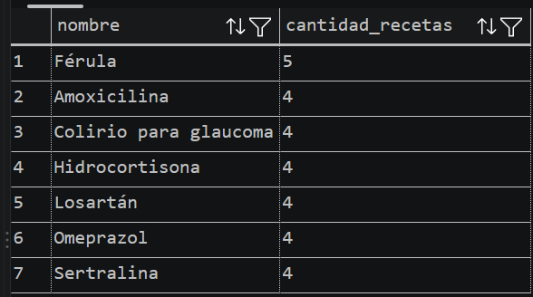

### Consigna 16

Obtener la información de la última consulta realizada por cada paciente requirió dividir el query en dos pasos. En primer lugar, se utilizó la expresión WITH, que permite definir una consulta temporal con nombre, y cuyo uso fue calcular la fecha más reciente de consulta de cada paciente agrupando por paciente y aplicando MAX sobre la fecha, para obtener la fecha más reciente correspondiente a cada uno. En segundo lugar, se unió ese resultado con la tabla Consultas mediante un INNER JOIN, utilizando como condición que coincidan tanto el paciente como la fecha, lo que permite recuperar exactamente la última consulta de cada uno y su diagnóstico; finalmente, se unió con Pacientes con otro INNER JOIN para obtener el nombre del paciente. El resultado incluye a los 25 pacientes que registran consultas.

```sql
WITH ultimas AS (
    SELECT id_paciente, MAX(fecha) AS ultima_fecha
    FROM Consultas
    GROUP BY id_paciente
)
SELECT Consultas.id_paciente,
    Pacientes.nombre,
    Consultas.diagnostico,
    Consultas.fecha AS ultima_consulta
FROM ultimas
INNER JOIN Consultas ON Consultas.id_paciente = ultimas.id_paciente
                    AND Consultas.fecha = ultimas.ultima_fecha
INNER JOIN Pacientes ON Pacientes.id_paciente = Consultas.id_paciente
ORDER BY Consultas.id_paciente;
```

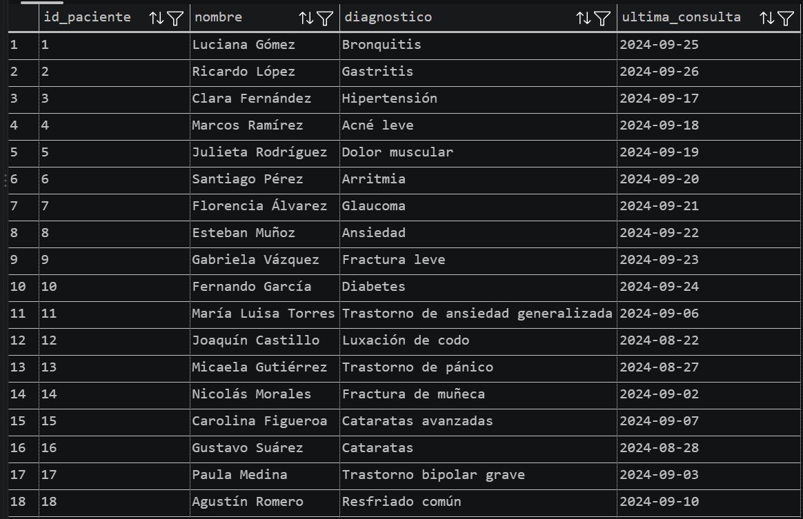

### Consigna 17

Al unir la tabla Consultas con Medicos y con Pacientes con dos INNER JOIN se pudo obtener la cantidad de consultas realizadas por cada médico a cada paciente (conociendo el nombre y id de cada uno de ellos, tanto del médico como del paciente). Luego se agrupó por la combinación médico–paciente, contando las consultas de cada grupo. El agrupamiento incluye los identificadores además de los nombres, para que dos personas con el mismo nombre no se consideran una sola. El resultado, ordenado por médico y paciente, contiene 66 combinaciones distintas.

```sql
SELECT Medicos.id_medico,
    Medicos.nombre AS "Nombre Medico",
    Pacientes.id_paciente,
    Pacientes.nombre AS "Nombre Paciente",
    COUNT(*) AS "Cant Consultas"
FROM Consultas
INNER JOIN Medicos ON Medicos.id_medico = Consultas.id_medico
INNER JOIN Pacientes ON Pacientes.id_paciente = Consultas.id_paciente
GROUP BY Medicos.nombre, Pacientes.nombre, Medicos.id_medico, Pacientes.id_paciente
ORDER BY Medicos.nombre, Pacientes.nombre ASC
```

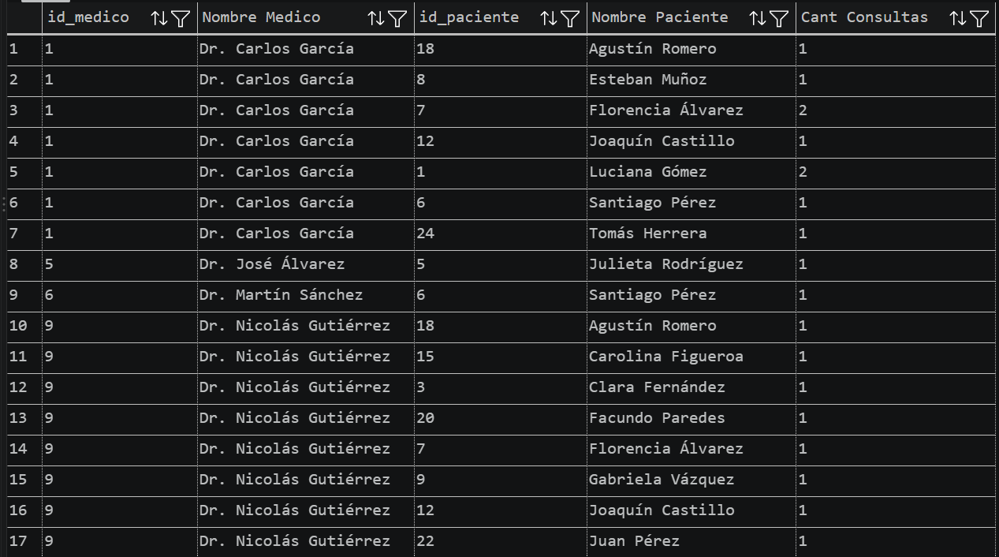

### Consigna 18

En esta consigna fue necesario combinar tanto la cantidad total de recetas de cada medicamento como los datos del médico y del paciente correspondientes a cada receta. Para resolverlo, primero se utilizó una expresión WITH denominada Total_Rec, que parte de la tabla Medicamentos y la relaciona con Recetas mediante INNER JOIN. Luego se agrupa por identificador de medicamento y se utiliza COUNT para calcular cuántas recetas corresponden a cada uno. En la consulta principal también se parte de Medicamentos, que se relaciona con Recetas para obtener cada prescripción registrada. Posteriormente, mediante INNER JOIN con Medicos y Pacientes, se incorporan los nombres del profesional que emitió la receta y del paciente que la recibió. Finalmente, se une el resultado con Total_Rec para agregar la cantidad total de recetas de cada medicamento y se ordenan las filas de mayor a menor según ese total. Como el conteo corresponde al medicamento en su conjunto, este valor se repite en todas las recetas de dicho medicamento. La consulta devuelve una fila por cada receta registrada, es decir, 45 filas. Los medicamentos sin receta no aparecen debido al uso de INNER JOIN.

```sql
WITH Total_Rec AS (
        SELECT
        m.id_medicamento,
        COUNT(r.id_receta) AS "Total Recetas"
        FROM Medicamentos m
        INNER JOIN Recetas r
        ON m.id_medicamento = r.id_medicamento
        GROUP BY m.id_medicamento
        )

SELECT
    m.nombre AS "Nombre Medicamento",
    tr."Total Recetas",
    me.nombre AS "Nombre Medico",
    p.nombre AS "Nombre Paciente"
FROM Medicamentos m
INNER JOIN Recetas r ON m.id_medicamento = r.id_medicamento
INNER JOIN Medicos me ON me.id_medico = r.id_medico
INNER JOIN Pacientes p ON p.id_paciente = r.id_paciente
INNER JOIN Total_Rec tr ON tr.id_medicamento = m.id_medicamento
ORDER BY tr."Total Recetas" DESC;
```

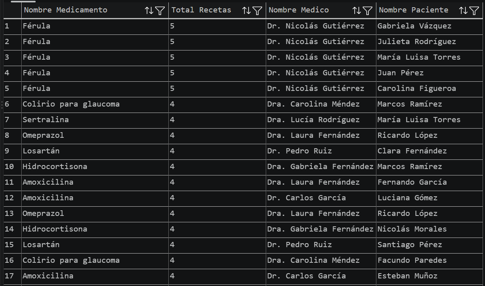

### Consigna 19

Para obtener la cantidad de pacientes distintos atendidos por cada médico se partió de la tabla Medicos y se realizó un LEFT JOIN con Consultas mediante id_medico. Se utilizó LEFT JOIN para incluir a todos los médicos registrados, incluso a aquellos que todavía no realizaron consultas. Posteriormente, se agruparon los resultados por identificador y nombre del médico. Para realizar el conteo se utilizó COUNT(DISTINCT Consultas.id_paciente), ya que un mismo paciente puede haber consultado varias veces con un profesional, pero debe contarse una sola vez. De esta manera, la consulta contabiliza pacientes diferentes en lugar de consultas realizadas. Los médicos sin consultas presentan un total de cero pacientes atendidos. Finalmente, los resultados se ordenaron de mayor a menor según la cantidad de pacientes distintos.

```sql
SELECT 
    Medicos.nombre,
    COUNT(DISTINCT Consultas.id_paciente) AS total_pacientes_antendidos
FROM Medicos
LEFT JOIN Consultas ON Medicos.id_medico = Consultas.id_medico
GROUP BY Medicos.id_medico, Medicos.nombre
ORDER BY total_pacientes_antendidos DESC
```

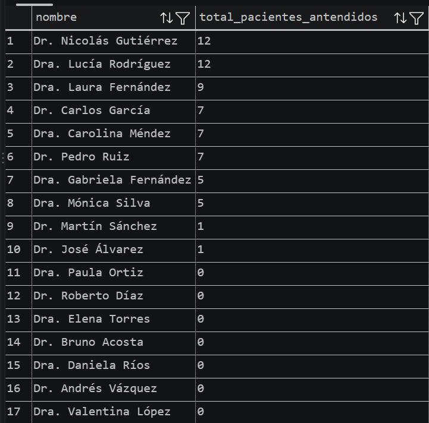

### Consigna 20

Para obtener la cantidad de consultas realizadas a pacientes menores de edad por cada médico, se partió de la tabla Medicos y se realizaron LEFT JOIN con Consultas, Pacientes y Especialidades. Se utilizó LEFT JOIN para conservar a todos los médicos registrados, incluidos aquellos que no realizaron consultas. La tabla Pacientes permite acceder a la fecha de nacimiento de las personas atendidas, mientras que Especialidades permite identificar la especialidad de cada médico. La edad se calculó mediante AGE, utilizando la fecha de la consulta y la fecha de nacimiento del paciente. Luego se aplicó EXTRACT(YEAR FROM ...) para obtener los años cumplidos al momento de la atención y determinar si el paciente era menor de 18 años en esa fecha. Para contar únicamente esas consultas se utilizó COUNT(Consultas.id_consulta) FILTER (WHERE ...), aplicando la condición de edad menor a 18 años. De esta manera, se contabilizan las consultas a menores sin excluir del resultado a los médicos que no realizaron ninguna. La columna es_pediatra se obtuvo mediante la comparación entre el nombre de la especialidad y 'Pediatría', que devuelve TRUE o FALSE. Además, se utilizó COALESCE para devolver FALSE cuando el médico no tiene una especialidad registrada y la comparación produciría un valor NULL. Finalmente, los registros se agruparon por médico y especialidad, y se ordenaron de mayor a menor según la cantidad de consultas realizadas a menores de edad.

```sql
SELECT
    Medicos.nombre,
    COUNT(Consultas.id_consulta) FILTER (
        WHERE EXTRACT(YEAR FROM AGE(Consultas.fecha, Pacientes.fecha_nacimiento)) < 18
        ) AS consultas_menores,
    COALESCE(Especialidades.nombre = 'Pediatría', FALSE) AS es_pediatra
FROM Medicos
LEFT JOIN Consultas ON Medicos.id_medico = Consultas.id_medico
LEFT JOIN Pacientes ON Pacientes.id_paciente = Consultas.id_paciente
LEFT JOIN Especialidades ON Especialidades.id_especialidad = Medicos.especialidad_id
GROUP BY Medicos.id_medico, Medicos.nombre, Especialidades.nombre
ORDER BY consultas_menores DESC;
```

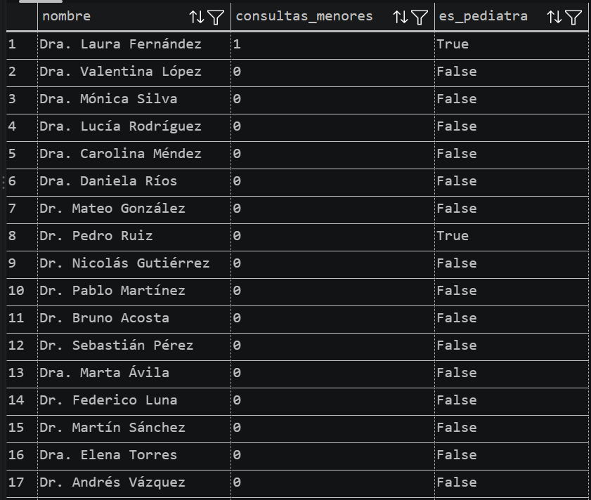
